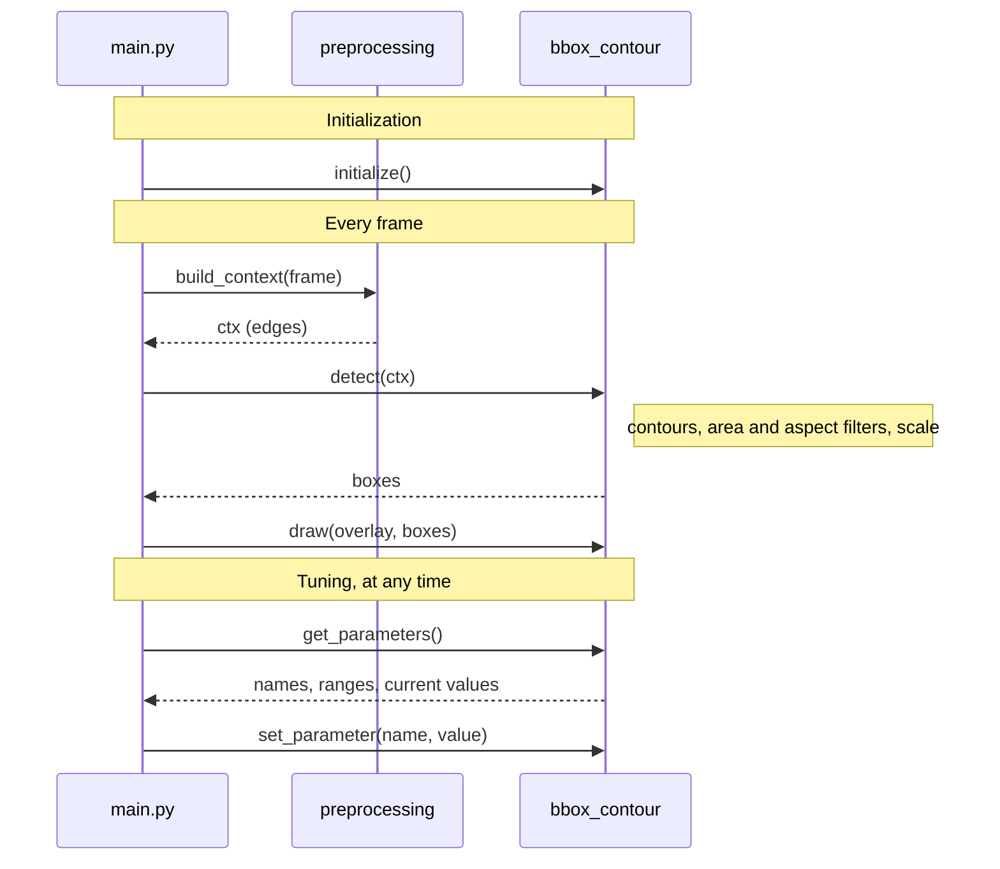

# SWS BBox Standard Contour (MID)

## 1 Introduction and functional overview

The `bbox_standard_contour` module detects candidate objects as bounding boxes from the contour image of the frame: it takes the external contours of `ctx.edges`, keeps those whose area and aspect ratio fit the limits of its parameters, and returns the bounding rectangle of each, optionally enlarged around its centre.

The module has no state. Its five filtering parameters are global variables of the module, adjustable at run time with `get_parameters`, `get_parameter` and `set_parameter`. There is one set of values per module, shared by all its callers (`map_standard_fusion`, the views of the HMI and `bbox_standard_tuning`).

## 2 Acronyms and Abbreviations

| Abbreviation / Acronym | Description |
| --- | --- |
| Box | Axis-aligned rectangle `(x1, y1, x2, y2)` in pixels, `(x1, y1)` top left and `(x2, y2)` bottom right. |
| `ctx` | `FrameContext`: `frame`, `gray` and `edges`, computed once per frame. |

## 3 Constraints and assumptions

- `ctx.edges` is a single-channel `uint8` contour image built by `preprocessing` (Canny, then morphological closing). *Why:* the module does not compute contours; the thresholds of that preprocessing are shared by all the detection modules and are not parameters of this module.
- The area filter applies to the area of the contour (`cv2.contourArea`), not to the area of its bounding rectangle. *Why:* an open or thin contour has a small area whatever the size of its box, so lines and isolated edges are rejected.
- Only external contours are used (`cv2.RETR_EXTERNAL`). *Why:* a contour inside another one is a detail of the same object and would give a nested box.
- The parameters are checked one by one, not together. *Why:* `set_parameter` checks each value against its own range; a combination such as `MIN_AREA_PX2 > MAX_AREA_PX2` gives no box and is not reported. The content of `ctx.edges` is not checked either, to keep the cost per frame low.

## 4 Dependencies to other modules

The module `bbox_standard_contour` has interfaces and dependencies to the following modules:

### 4.1 Internal modules

| Module | Interface | Description |
| --- | --- | --- |
| `preprocessing` | `FrameContext` | `ctx.edges`: contour image of the frame, computed once per frame. |

### 4.2 External dependencies

| Library | Functions used | Description |
| --- | --- | --- |
| OpenCV (`cv2`) | `findContours`, `contourArea`, `boundingRect`, `rectangle` | Contour extraction, filtering and drawing. |

## 5 Functional specification

A contour gives a box if its area and its aspect ratio are inside the limits of the parameters; the box is the bounding rectangle of the contour, scaled around its centre by `SCALE_RATIO` and clamped to the image.

### 5.1 Box model

**[SWS_BBoxContour_00001]** A box is a tuple of four `int`, `(x1, y1, x2, y2)`, in pixels. The origin is the top left corner of the image, x grows to the right and y grows downward.

**[SWS_BBoxContour_00002]** A returned box satisfies `0 <= x1 <= x2 <= width` and `0 <= y1 <= y2 <= height`, where `width` and `height` are the size of `ctx.edges`. The boxes are used as pixel indices by the callers (projection in the map, surfaces in the tuning); clamping guarantees that they never leave the image.

### 5.2 Detection

**[SWS_BBoxContour_00010]** The contours are the external contours of `ctx.edges` (`cv2.RETR_EXTERNAL`, `cv2.CHAIN_APPROX_SIMPLE`). `RETR_EXTERNAL` avoids boxes nested in a larger one; `CHAIN_APPROX_SIMPLE` keeps only the corner points, which is enough for the area and the bounding rectangle and is cheaper.

**[SWS_BBoxContour_00011]** A contour is rejected if its area is lower than `MIN_AREA_PX2` or greater than `MAX_AREA_PX2`. The lower limit rejects noise and fine texture; the upper limit rejects contours that are the whole scene (borders, walls).

**[SWS_BBoxContour_00012]** The aspect ratio of a contour is `w / h`, with `w` and `h` the width and height of its bounding rectangle (`cv2.boundingRect`). A contour is rejected if the ratio is lower than `MIN_ASPECT_RATIO` or greater than `MAX_ASPECT_RATIO`. Very flat or very tall boxes are mostly edges of the floor, of walls or of door frames, not obstacles.

**[SWS_BBoxContour_00013]** The box of an accepted contour is its bounding rectangle scaled by `SCALE_RATIO` around its centre: the centre is `(x + w // 2, y + h // 2)`, the new size is `int(w * SCALE_RATIO)` by `int(h * SCALE_RATIO)`, and the result is clamped to the image (SWS_BBoxContour_00002). `SCALE_RATIO = 1.0` gives the bounding rectangle itself. Scaling around the centre keeps the box centred on the object. `SCALE_RATIO = 1.0` keeps the real bottom edge, which `map_standard_fusion` uses as the contact with the ground.

**[SWS_BBoxContour_00014]** The boxes are returned in the order of the contours given by OpenCV. Two contours may give overlapping or identical boxes; the module does not merge them. Merging boxes would need an overlap rule; the callers already handle overlaps (the map writes cells, the tuning uses the union of surfaces).

### 5.3 Parameters

**[SWS_BBoxContour_00020]** The module has five parameters, which are global variables of the module: `MIN_AREA_PX2`, `MAX_AREA_PX2`, `MIN_ASPECT_RATIO`, `MAX_ASPECT_RATIO` and `SCALE_RATIO`. Their default values, types and ranges are in section 8. There is one set of values per module.

**[SWS_BBoxContour_00021]** All the parameters can be changed at run time (section 8.1) with `set_parameter`; the new value is used from the next call of `detect`. `get_parameters` lists them with their current value and `get_parameter` returns the current value of one of them. The module has no parameter that requires a new `initialize` (section 8.2). The values are read at each call, so the HMI or the tuning can change them between two frames without restarting the module.

**[SWS_BBoxContour_00022]** `set_parameter` refuses an unknown name, a value that is not a number of the type of the parameter (a boolean is refused) and a value outside the range of section 8 (`BBOX_E_BAD_PARAMETER`); the parameter is then unchanged. A refused value leaves the previous valid set in place; a bad value would otherwise silently give no box.

### 5.4 Error classification

**[SWS_BBoxContour_00030]** The only error code of the module is `BBOX_E_BAD_PARAMETER` (SWS_BBoxContour_00022), raised as `ValueError` (Development error). An exception raised by Python or OpenCV (for example if `ctx.edges` does not exist) is not caught.

| Error code | Value | Type | Description |
| --- | --- | --- | --- |
| `BBOX_E_BAD_PARAMETER` | 0x01 | Development | Unknown parameter name, wrong type or value out of range given to `set_parameter` or `get_parameter`: `ValueError`. |

## 6 API specification

The module exposes the four common functions `initialize`, `calibrate`, `detect` and `draw`, plus `get_parameters`, `get_parameter` and `set_parameter`.

### 6.1 Type definitions

The following Data Types shall be used for the functions defined in this specification.

**[SWS_BBoxContour_00050]** Type definitions of the module:

| Name | Kind | Range | Description |
| --- | --- | --- | --- |
| `Box` | `tuple[int, int, int, int]` | SWS_BBoxContour_00002 | Box `(x1, y1, x2, y2)` in pixels. |

### 6.2 Function definitions

This is a list of functions provided for upper layer modules.

#### 6.2.1 initialize

**[SWS_BBoxContour_00100]** Definition of `initialize`:

| Service name | `initialize` |
| --- | --- |
| Syntax | `initialize() -> None` |
| Sync/Async | Synchronous |
| Reentrancy | Reentrant |
| Parameters (in) | None |
| Return value | None |
| Description | Minimum implementation to satisfy the common detection module interface. |

#### 6.2.2 calibrate

**[SWS_BBoxContour_00101]** Definition of `calibrate`:

| Service name | `calibrate` |
| --- | --- |
| Syntax | `calibrate(ctx=None) -> None` |
| Sync/Async | Synchronous |
| Reentrancy | Reentrant |
| Parameters (in) | `ctx`: ignored. |
| Return value | None |
| Description | Minimum implementation to satisfy the common detection module interface. |

#### 6.2.3 detect

**[SWS_BBoxContour_00102]** Definition of `detect`:

| Service name | `detect` |
| --- | --- |
| Syntax | `detect(ctx) -> list[Box]` |
| Sync/Async | Synchronous |
| Reentrancy | Reentrant |
| Parameters (in) | `ctx`: `FrameContext` of the current frame. |
| Return value | The boxes of 5.2; an empty list if no contour is accepted. |
| Description | Applies SWS_BBoxContour_00010 to 00014 with the current values of the parameters. |

#### 6.2.4 draw

**[SWS_BBoxContour_00103]** Definition of `draw`:

| Service name | `draw` |
| --- | --- |
| Syntax | `draw(overlay, boxes, color=(0, 255, 0), thickness=2) -> None` |
| Sync/Async | Synchronous |
| Reentrancy | Reentrant |
| Parameters (in) | `overlay`: BGR image, modified in place. `boxes`: result of `detect`. `color`: BGR colour. `thickness`: line width in pixels. |
| Return value | None |
| Description | Draws every box as a rectangle on `overlay`. |

#### 6.2.5 get_parameters

**[SWS_BBoxContour_00104]** Definition of `get_parameters`:

| Service name | `get_parameters` |
| --- | --- |
| Syntax | `get_parameters() -> list[dict]` |
| Sync/Async | Synchronous |
| Reentrancy | Reentrant |
| Parameters (in) | None |
| Return value | One `dict` per parameter adjustable at run time (section 8.1), with the keys `name`, `type` (`"int"` or `"float"`), `minimum`, `maximum`, `unit`, `description` and `value` (current value). |
| Description | Describes the parameters for the HMI and for `bbox_standard_tuning`. |

#### 6.2.6 get_parameter

**[SWS_BBoxContour_00105]** Definition of `get_parameter`:

| Service name | `get_parameter` |
| --- | --- |
| Syntax | `get_parameter(name) -> int or float` |
| Sync/Async | Synchronous |
| Reentrancy | Reentrant |
| Parameters (in) | `name`: name of a parameter of section 8.1. |
| Return value | Current value of the parameter. |
| Description | Raises `ValueError` (`BBOX_E_BAD_PARAMETER`) for an unknown name. |

#### 6.2.7 set_parameter

**[SWS_BBoxContour_00106]** Definition of `set_parameter`:

| Service name | `set_parameter` |
| --- | --- |
| Syntax | `set_parameter(name, value) -> None` |
| Sync/Async | Synchronous |
| Reentrancy | Non-reentrant (writes a global variable) |
| Parameters (in) | `name`: name of a parameter of section 8.1. `value`: new value, of the type and in the range of section 8. |
| Return value | None |
| Description | Applies SWS_BBoxContour_00022 and stores the value; it is used from the next call of `detect`. |

## 7 Sequence diagrams

## 8 Configuration specification

The parameters are global variables at the top of `bbox_standard_contour.py`. There is one set of values per module.

### 8.1 Parameters adjustable at run time

Available through `get_parameters`, `get_parameter` and `set_parameter`; a new value is used from the next call of `detect`.

| Parameter name | Type | Range | Default | Unit | Description |
| --- | --- | --- | --- | --- | --- |
| `MIN_AREA_PX2` | float | [0, 1e9] | 200 | px² | Smallest contour area accepted, in pixels². |
| `MAX_AREA_PX2` | float | [0, 1e9] | 200000 | px² | Largest contour area accepted, in pixels². |
| `MIN_ASPECT_RATIO` | float | [0.001, 1000] | 0.1 | ratio | Smallest `width / height` accepted. |
| `MAX_ASPECT_RATIO` | float | [0.001, 1000] | 10 | ratio | Largest `width / height` accepted. |
| `SCALE_RATIO` | float | [0.1, 10] | 1.0 | ratio | Enlargement of the bounding rectangle around its centre; 1.0 means none. |

### 8.2 Parameters that require `initialize`

None.
