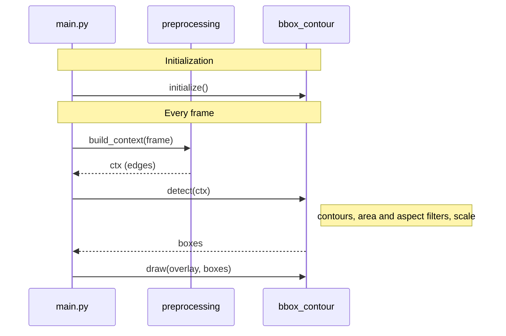

# SWS BBox Standard Contour (MID)

Module: `bbox_standard_contour.py` · Status: draft 0.3 · Date: 2026-11-14

## 1 Introduction and functional overview

The `bbox_standard_contour` module detects candidate objects as bounding boxes from the contour image of the frame: it takes the external contours of `ctx.edges`, keeps those whose area and aspect ratio fit the limits given to `detect`, and returns the bounding rectangle of each, optionally enlarged around its centre.

The module has no state. Its five filtering parameters are arguments of `detect` with default values, so every caller can use its own values: `map_standard_fusion` asks for no enlargement, and `bbox_standard_tuning` passes the parameters it tests.

Out of scope for this version: contour computation (done once per frame by `preprocessing`), classification of the boxes, tracking, and automatic parameter search.

## 2 Acronyms and Abbreviations

| Abbreviation / Acronym | Description |
| --- | --- |
| Box | Axis-aligned rectangle `(x1, y1, x2, y2)` in pixels, `(x1, y1)` top left and `(x2, y2)` bottom right. |
| `ctx` | `FrameContext`: `frame`, `gray` and `edges`, computed once per frame. |

## 3 Constraints and assumptions

| ID | Assumption |
| --- | --- |
| B1 | `ctx.edges` is a single-channel `uint8` image (Canny followed by morphological closing) built by `preprocessing`. The thresholds of that preprocessing are shared by all modules and are not parameters of this module. |
| B2 | The area filter applies to the area of the contour (`cv2.contourArea`), not to the area of its bounding rectangle. The area of an open or thin contour is small, whatever the size of its box. |
| B3 | Only external contours are used (`cv2.RETR_EXTERNAL`): a contour inside another one gives no box. |
| B4 | The module does not check its inputs: it neither validates the parameters (for example `min_area > max_area` gives no box) nor the content of `ctx.edges`. |
| B5 | Python with OpenCV only; no TensorFlow in this module. |

## 4 Dependencies to other modules

`bbox_standard_contour` does not call any other module of the project; it only reads the `ctx` it receives.

### 4.1 Internal modules

| Module | Interface | Description |
| --- | --- | --- |
| `preprocessing` | `FrameContext` | `ctx.edges`: contour image of the frame, computed once per frame. |

### 4.2 External dependencies

| Library | Functions used | Description |
| --- | --- | --- |
| OpenCV (`cv2`) | `findContours`, `contourArea`, `boundingRect`, `rectangle` | Contour extraction, filtering and drawing. |

## 5 Functional specification

A contour gives a box if its area and its aspect ratio are inside the limits of the parameters; the box is the bounding rectangle of the contour, scaled around its centre by `scale` and clamped to the image.

### 5.1 Box model

**[SWS_BBoxContour_00001]** ⌈ A box is a tuple of four `int`, `(x1, y1, x2, y2)`, in pixels. The origin is the top left corner of the image, x grows to the right and y grows downward. ⌋

**[SWS_BBoxContour_00002]** ⌈ A returned box satisfies `0 <= x1 <= x2 <= width` and `0 <= y1 <= y2 <= height`, where `width` and `height` are the size of `ctx.edges`. ⌋

### 5.2 Detection

**[SWS_BBoxContour_00010]** ⌈ The contours are the external contours of `ctx.edges` (`cv2.RETR_EXTERNAL`, `cv2.CHAIN_APPROX_SIMPLE`). ⌋

**[SWS_BBoxContour_00011]** ⌈ A contour is rejected if its area is lower than `min_area` or greater than `max_area`. ⌋

**[SWS_BBoxContour_00012]** ⌈ The aspect ratio of a contour is `w / h`, with `w` and `h` the width and height of its bounding rectangle (`cv2.boundingRect`). A contour is rejected if the ratio is lower than `min_aspect` or greater than `max_aspect`. ⌋

**[SWS_BBoxContour_00013]** ⌈ The box of an accepted contour is its bounding rectangle scaled by `scale` around its centre: the centre is `(x + w // 2, y + h // 2)`, the new size is `int(w * scale)` by `int(h * scale)`, and the result is clamped to the image (SWS_BBoxContour_00002). `scale = 1.0` gives the bounding rectangle itself. ⌋

**[SWS_BBoxContour_00014]** ⌈ The boxes are returned in the order of the contours given by OpenCV. Two contours may give overlapping or identical boxes; the module does not merge them. ⌋

### 5.3 Parameters

**[SWS_BBoxContour_00020]** ⌈ The module has five parameters, which are arguments of `detect`: `min_area`, `max_area`, `min_aspect`, `max_aspect` and `scale`. An argument that is not given takes the default of section 8. The values apply to that call only; the module keeps no parameter between two calls. ⌋

### 5.4 Error classification

**[SWS_BBoxContour_00030]** ⌈ The module reports no error code (B4). An exception raised by Python or OpenCV (for example if `ctx.edges` does not exist) is not caught. ⌋

## 6 API specification

The module exposes the four common functions `initialize`, `calibrate`, `detect` and `draw`.

### 6.1 Type definitions

**[SWS_BBoxContour_00050]** ⌈ Type definitions of the module: ⌋

| Name | Kind | Range | Description |
| --- | --- | --- | --- |
| `Box` | `tuple[int, int, int, int]` | SWS_BBoxContour_00002 | Box `(x1, y1, x2, y2)` in pixels. |

### 6.2 Function definitions

#### 6.2.1 initialize

**[SWS_BBoxContour_00100]** ⌈ Definition of `initialize`: ⌋

| Service name | `initialize` |
| --- | --- |
| Syntax | `initialize() -> None` |
| Sync/Async | Synchronous |
| Reentrancy | Reentrant |
| Parameters (in) | None |
| Return value | None |
| Description | The module is stateless: prints a message and does nothing else. Present for the common interface of the detection modules. |

#### 6.2.2 calibrate

**[SWS_BBoxContour_00101]** ⌈ Definition of `calibrate`: ⌋

| Service name | `calibrate` |
| --- | --- |
| Syntax | `calibrate(ctx=None) -> None` |
| Sync/Async | Synchronous |
| Reentrancy | Reentrant |
| Parameters (in) | `ctx`: ignored. |
| Return value | None |
| Description | Nothing to learn: prints a message and does nothing else. Present for the common interface of the detection modules. |

#### 6.2.3 detect

**[SWS_BBoxContour_00102]** ⌈ Definition of `detect`: ⌋

| Service name | `detect` |
| --- | --- |
| Syntax | `detect(ctx, min_area=200, max_area=200000, min_aspect=0.1, max_aspect=10, scale=1.3) -> list[Box]` |
| Sync/Async | Synchronous |
| Reentrancy | Reentrant |
| Parameters (in) | `ctx`: `FrameContext` of the current frame. `min_area`, `max_area`, `min_aspect`, `max_aspect`, `scale`: parameters of 5.3. |
| Return value | The boxes of 5.2; an empty list if no contour is accepted. |
| Description | Applies SWS_BBoxContour_00010 to 00014. |

#### 6.2.4 draw

**[SWS_BBoxContour_00103]** ⌈ Definition of `draw`: ⌋

| Service name | `draw` |
| --- | --- |
| Syntax | `draw(overlay, boxes, color=(0, 255, 0), thickness=2) -> None` |
| Sync/Async | Synchronous |
| Reentrancy | Reentrant |
| Parameters (in) | `overlay`: BGR image, modified in place. `boxes`: result of `detect`. `color`: BGR colour. `thickness`: line width in pixels. |
| Return value | None |
| Description | Draws every box as a rectangle on `overlay`. |

## 7 Sequence diagrams

A caller that needs other values (`map_standard_fusion`, `bbox_standard_tuning`) gives them as arguments of `detect`.

## 8 Configuration specification

The parameters are the arguments of `detect`; the defaults are written in its signature, not in module constants.

| Parameter name | Type | Range | Default | Description |
| --- | --- | --- | --- | --- |
| `min_area` | float | ≥ 0 | 200 | Smallest contour area accepted, in pixels². |
| `max_area` | float | ≥ `min_area` | 200000 | Largest contour area accepted, in pixels². |
| `min_aspect` | float | > 0 | 0.1 | Smallest `width / height` accepted. |
| `max_aspect` | float | ≥ `min_aspect` | 10 | Largest `width / height` accepted. |
| `scale` | float | > 0 | 1.3 | Enlargement of the bounding rectangle around its centre; 1.0 means none. `map_standard_fusion` asks for 1.0. |
