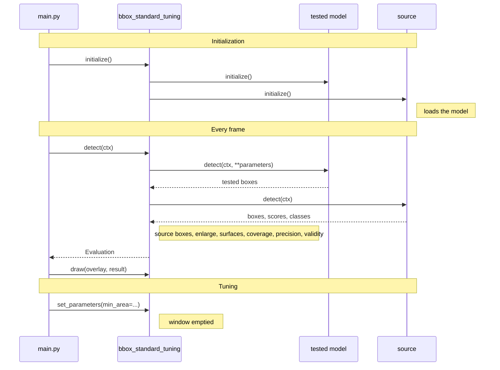

# SWS BBox Standard Tuning (MID)

## 1 Introduction and functional overview

The `bbox_standard_tuning` module helps to tune a bounding-box model, the **tested model** (today `bbox_standard_contour`), against a **source of truth** (today `object_tensorflow_ssd`). At every frame it runs both models, projects the boxes of the source on the image of the tested model, enlarges them by 15 %, and compares the surface they share with the boxes of the tested model. The result is a **validity** score between 0 and 1, the harmonic mean of two sub-scores: the **coverage** (does the tested model cover the source objects?) and the **precision** (do its boxes stay within the source objects, with a margin of 15 %?).

The parameters belong to the tested model (they are the arguments of its `detect`, with their defaults); the module knows them, keeps the values under test and passes them to the tested model at every frame. The operator changes the set with `set_parameters` and watches the score evolve in the HMI view of the module. The source and the tested model are configuration items: any module with the interface of 3 (V7, V8) can replace them. The code and the defaults of the models are never changed.

## 2 Acronyms and Abbreviations

| Abbreviation / Acronym | Description |
| --- | --- |
| Box | Axis-aligned rectangle `(x1, y1, x2, y2)` in pixels, `(x1, y1)` top left and `(x2, y2)` bottom right. |
| Source | Model taken as the truth (`SOURCE_MODEL`, section 8). Its boxes are the source boxes. |
| Tested | Model whose boxes and parameters are evaluated (`TESTED_MODEL`). Its boxes are the tested boxes. |
| Enlarged source box | Source box scaled by `1 + MARGIN_RATIO` on each dimension around its centre (SWS_BBoxTuning_00020). |
| Coverage, precision, validity | Sub-scores and final score of 5.3, between 0 and 1. |
| `ctx` | `FrameContext`: `frame`, `gray` and `edges`, computed once per frame. |

## 3 Constraints and assumptions

The score is only as good as the source; otherwise it is wrong and the module cannot detect it.

| ID | Assumption |
| --- | --- |
| V1 | The source is the truth. An object that it does not detect (or detects below `SCORE_THRESHOLD`) is a false positive for the tested model, and an object outside the classes of the source cannot be covered. |
| V2 | The source gives normalised boxes `(ymin, xmin, ymax, xmax)` in `[0, 1]`; the module converts them to pixels with the size of `ctx.frame`. |
| V3 | Both models receive the same `ctx`, hence the same frame; the boxes of both are in the pixels of that frame. |
| V4 | The evaluation is per frame, without tracking and without pairing of boxes: the surfaces of all the boxes of a model are merged (union). |
| V5 | The source runs an inference at each call. The module runs its own inference even if the source is also active in the HMI: the double inference is accepted. |
| V6 | TensorFlow and the model of the default source are installed; otherwise the source is unavailable (`TUN_E_SOURCE_FAILED`). |
| V7 | The tested model is a module with `initialize()` and `detect(ctx, **parameters)` that returns a list of boxes in pixels; its parameters are keyword arguments of `detect` that all have a default value. |
| V8 | The source is a module with `initialize()` and `detect(ctx)` that returns `(boxes, scores, classes)` as `object_tensorflow_ssd` does. |

## 4 Dependencies to other modules

`bbox_standard_tuning` calls the modules below itself; it does not need any result precomputed by `main.py`.

### 4.1 Internal modules

| Module | Interface | Description |
| --- | --- | --- |
| `bbox_standard_contour` (`bbox_contour`) | `initialize()`, `detect(ctx, min_area, max_area, min_aspect, max_aspect, scale)` | Default tested model (`TESTED_MODEL`); boxes computed with the parameters under test. |
| `object_tensorflow_ssd` (`object_tf`) | `initialize()`, `detect(ctx)` | Default source (`SOURCE_MODEL`): `(boxes, scores, classes)`, boxes normalised `(ymin, xmin, ymax, xmax)`. |
| `preprocessing` | `FrameContext` | `frame`, `gray` and `edges`, computed once per frame. |

### 4.2 External dependencies

| Library | Functions used | Description |
| --- | --- | --- |
| OpenCV (`cv2`) | `rectangle`, `putText` | Drawing of the boxes and of the score. |
| NumPy | `ndarray`, `count_nonzero`, `logical_and` | Surface masks and their intersection. |

## 5 Functional specification

The source boxes, enlarged by `MARGIN_RATIO`, are drawn as a surface on the image of the tested model; the surface shared with the tested boxes, compared with the surface of the source and with the surface of the tested boxes, gives the coverage and the precision; their harmonic mean is the validity.

### 5.1 Box model

**[SWS_BBoxTuning_00001]** ⌈ All boxes handled by the module are tuples `(x1, y1, x2, y2)` in pixels, with the origin at the top left corner of the image. ⌋

**[SWS_BBoxTuning_00002]** ⌈ A box of the source `(ymin, xmin, ymax, xmax)` is converted to `(int(xmin * w), int(ymin * h), int(xmax * w), int(ymax * h))`, with `w` and `h` the width and height of `ctx.frame`. ⌋

### 5.2 Source selection

**[SWS_BBoxTuning_00010]** ⌈ A box of the source is a source box if its score is greater than or equal to `SCORE_THRESHOLD` and, when `CLASS_FILTER` is not `None`, if its class is in `CLASS_FILTER`. ⌋

**[SWS_BBoxTuning_00011]** ⌈ A box of the source with a null or negative size after conversion is ignored. ⌋

### 5.3 Surfaces and scores

**[SWS_BBoxTuning_00020]** ⌈ The enlarged box of a source box of centre `(cx, cy)`, width `w` and height `h` is the rectangle of centre `(cx, cy)`, width `w * (1 + MARGIN_RATIO)` and height `h * (1 + MARGIN_RATIO)`, rounded to pixels and clamped to the image. ⌋

**[SWS_BBoxTuning_00021]** ⌈ Three surfaces are built at the size of `ctx.frame`, each as the union of the pixels of the rectangles of its boxes (a pixel covered by several boxes counts once): `T` for the tested boxes, `S` for the source boxes, and `S+` for the enlarged source boxes. `|X|` is the number of pixels of the surface `X`. ⌋

**[SWS_BBoxTuning_00022]** ⌈ The coverage of a frame is `coverage = |T ∩ S| / |S|`: the share of the source surface that the tested boxes cover. It is 1 when the tested boxes cover all the source boxes. ⌋

**[SWS_BBoxTuning_00023]** ⌈ The precision of a frame is `precision = |T ∩ S+| / |T|`: the share of the tested surface that lies inside the enlarged source. It is 1 when no tested box goes beyond the source boxes by more than the margin, and it decreases when the tested boxes are too large or have no source. ⌋

**[SWS_BBoxTuning_00024]** ⌈ The validity of a frame is the harmonic mean of the two sub-scores: `validity = 2 * coverage * precision / (coverage + precision)`, and 0 if `coverage + precision = 0`. A tested box whose surface lies between a source box and its enlarged box gives coverage 1, precision 1 and validity 1: the margin is the tolerance. ⌋

**[SWS_BBoxTuning_00025]** ⌈ A denominator equal to 0 gives a ratio of 0, except when `|T| = 0` and `|S| = 0` (neither model detects anything): the frame has no information and is not scored (its three scores are `None`). ⌋

### 5.4 Statistics

**[SWS_BBoxTuning_00030]** ⌈ For each scored frame whose source was available, the module stores `coverage`, `precision` and `validity` in a window of the last `STATS_WINDOW_FRAMES` frames. ⌋

**[SWS_BBoxTuning_00031]** ⌈ The window scores `window_coverage`, `window_precision` and `window_validity` are the means of the stored values; they are `None` if the window is empty. ⌋

**[SWS_BBoxTuning_00032]** ⌈ A frame without information (SWS_BBoxTuning_00025) or without source (`TUN_E_SOURCE_FAILED`) is not added to the window. `reset_statistics`, `set_parameters` and `initialize` empty the window. ⌋

### 5.5 Parameters under test

**[SWS_BBoxTuning_00035]** ⌈ The parameters are defined by `TESTED_MODEL`; the module only knows their names (arguments of `TESTED_MODEL.detect`) and keeps the values under test, which it gives as keyword arguments at every frame. Their initial value is `TESTED_PARAMETERS` (section 8); a parameter that is absent takes the default of the model. ⌋

**[SWS_BBoxTuning_00036]** ⌈ `set_parameters` replaces the values of the given parameters, keeps the others, and empties the window, so that the score only reflects the new values. A name that is not an argument of `TESTED_MODEL.detect` (other than `ctx`) is refused as a whole (`TUN_E_BAD_PARAMETER`). The module does not check the values: that is the job of the tested model. ⌋

### 5.6 Display

**[SWS_BBoxTuning_00040]** ⌈ `draw` shows on the frame the tested boxes in green, the source boxes in orange and the enlarged source boxes as a thin gray rectangle. A first text line gives the coverage, the precision and the validity of the window, and a second line gives the parameters under test. If the source was not available, the tested boxes are gray. ⌋

### 5.7 Error classification

| Error code | Value [hex] | Type | Description |
| --- | --- | --- | --- |
| `TUN_E_NOT_INITIALIZED` | 0x01 | Development | `detect` called before `initialize`: `RuntimeError`. |
| `TUN_E_SOURCE_FAILED` | 0x02 | Runtime | Source unavailable or raising an error: a warning is printed once, the tested boxes are returned with `source_ok = False`, the scores are `None`, and the window is not updated. |
| `TUN_E_BAD_PARAMETER` | 0x03 | Development | Value of the configuration that is not valid (section 8) at `initialize`, or unknown parameter name given to `set_parameters`: `ValueError`. |

## 6 API specification

The module exposes the four common functions `initialize`, `calibrate`, `detect` and `draw`, plus `set_parameters` and `reset_statistics`.

### 6.1 Type definitions

**[SWS_BBoxTuning_00050]** ⌈ Type definitions of the module: ⌋

| Name | Kind | Range | Description |
| --- | --- | --- | --- |
| `Box` | `tuple[int, int, int, int]` | SWS_BBoxTuning_00001 | Box `(x1, y1, x2, y2)` in pixels. |
| `Evaluation` | `dataclass` | fields below | Result of `detect` for one frame. |

**[SWS_BBoxTuning_00051]** ⌈ Fields of `Evaluation`: ⌋

| Field | Type | Description |
| --- | --- | --- |
| `tested` | `list[Box]` | Boxes of the tested model. |
| `sources` | `list[Box]` | Source boxes of the frame (SWS_BBoxTuning_00010). |
| `enlarged` | `list[Box]` | Enlarged source boxes (SWS_BBoxTuning_00020). |
| `coverage`, `precision`, `validity` | `float \| None` | Scores of this frame (5.3); `None` if the frame is not scored. |
| `window_coverage`, `window_precision`, `window_validity` | `float \| None` | Means over the window, after this frame (5.4). |
| `window_frames` | `int` | Number of frames in the window. |
| `parameters` | `dict` | Parameters passed to `TESTED_MODEL.detect` for this frame. |
| `source_ok` | `bool` | `False` if the source was not available for this frame. |

### 6.2 Function definitions

#### 6.2.1 initialize

**[SWS_BBoxTuning_00100]** ⌈ Definition of `initialize`: ⌋

| Service name | `initialize` |
| --- | --- |
| Syntax | `initialize() -> None` |
| Sync/Async | Synchronous |
| Reentrancy | Non reentrant |
| Parameters (in) | None |
| Return value | None |
| Description | Initializes `TESTED_MODEL` and `SOURCE_MODEL` (the model of the default source is loaded there), checks the configuration (`TUN_E_BAD_PARAMETER`), restores `TESTED_PARAMETERS` and empties the window. Must be called once before any other function. |

#### 6.2.2 calibrate

**[SWS_BBoxTuning_00101]** ⌈ Definition of `calibrate`: ⌋

| Service name | `calibrate` |
| --- | --- |
| Syntax | `calibrate(ctx=None) -> None` |
| Sync/Async | Synchronous |
| Reentrancy | Reentrant |
| Parameters (in) | `ctx`: ignored. |
| Return value | None |
| Description | Minimum implementation to satisfy the common detection module interface. |

#### 6.2.3 detect

**[SWS_BBoxTuning_00102]** ⌈ Definition of `detect`: ⌋

| Service name | `detect` |
| --- | --- |
| Syntax | `detect(ctx) -> Evaluation` |
| Sync/Async | Synchronous |
| Reentrancy | Non reentrant |
| Parameters (in) | `ctx`: `FrameContext` of the current frame. |
| Return value | The `Evaluation` of the frame. |
| Description | Calls `TESTED_MODEL.detect(ctx, **parameters)` with the parameters under test and `SOURCE_MODEL.detect(ctx)`, selects the source boxes (5.2), builds the surfaces and computes the scores of the frame (5.3), updates the window and computes the window scores (5.4). If the source is not available, returns the tested boxes with `source_ok = False` (`TUN_E_SOURCE_FAILED`). |

#### 6.2.4 draw

**[SWS_BBoxTuning_00103]** ⌈ Definition of `draw`: ⌋

| Service name | `draw` |
| --- | --- |
| Syntax | `draw(overlay, result) -> None` |
| Sync/Async | Synchronous |
| Reentrancy | Non reentrant |
| Parameters (in) | `overlay`: BGR image of the view, modified in place. `result`: `Evaluation` returned by `detect`. |
| Return value | None |
| Description | Draws the boxes and the scores as in SWS_BBoxTuning_00040. |

#### 6.2.5 set_parameters

**[SWS_BBoxTuning_00104]** ⌈ Definition of `set_parameters`: ⌋

| Service name | `set_parameters` |
| --- | --- |
| Syntax | `set_parameters(**values) -> None` |
| Sync/Async | Synchronous |
| Reentrancy | Non reentrant |
| Parameters (in) | `values`: any argument of `TESTED_MODEL.detect` other than `ctx` (for `bbox_standard_contour`: `min_area`, `max_area`, `min_aspect`, `max_aspect`, `scale`). |
| Return value | None |
| Description | Changes the parameters under test (SWS_BBoxTuning_00036) and empties the window. Raises `ValueError` for an unknown name (`TUN_E_BAD_PARAMETER`). |

#### 6.2.6 reset_statistics

**[SWS_BBoxTuning_00105]** ⌈ Definition of `reset_statistics`: ⌋

| Service name | `reset_statistics` |
| --- | --- |
| Syntax | `reset_statistics() -> None` |
| Sync/Async | Synchronous |
| Reentrancy | Non reentrant |
| Parameters (in) | None |
| Return value | None |
| Description | Empties the window of statistics, to start a new measure with the same parameters. |

## 7 Sequence diagrams

The operator changes the parameters of the tested model through the module; the next frames use them and start a new measure.

## 8 Configuration specification

The parameters are constants at the top of `bbox_standard_tuning.py`.

| Parameter name | Type | Range | Default | Description |
| --- | --- | --- | --- | --- |
| `TESTED_MODEL` | module | tested model (V7) | `bbox_standard_contour` | Model whose boxes are evaluated and whose parameters are tuned. |
| `TESTED_PARAMETERS` | dict | arguments of `TESTED_MODEL.detect` | `{}` | Initial parameters passed to `TESTED_MODEL.detect`; empty means the defaults of the model. |
| `SOURCE_MODEL` | module | source (V8) | `object_tensorflow_ssd` | Source of truth. |
| `MARGIN_RATIO` | float | ≥ 0 | 0.15 | Enlargement of each dimension of a source box (+15 %). |
| `SCORE_THRESHOLD` | float | [0, 1] | 0.5 | Smallest score of the source for a source box. |
| `CLASS_FILTER` | set of int or `None` | class identifiers of the source | `None` | Classes kept as source boxes; `None` keeps all. |
| `STATS_WINDOW_FRAMES` | int | ≥ 1 | 100 | Number of frames in the statistics window. |
