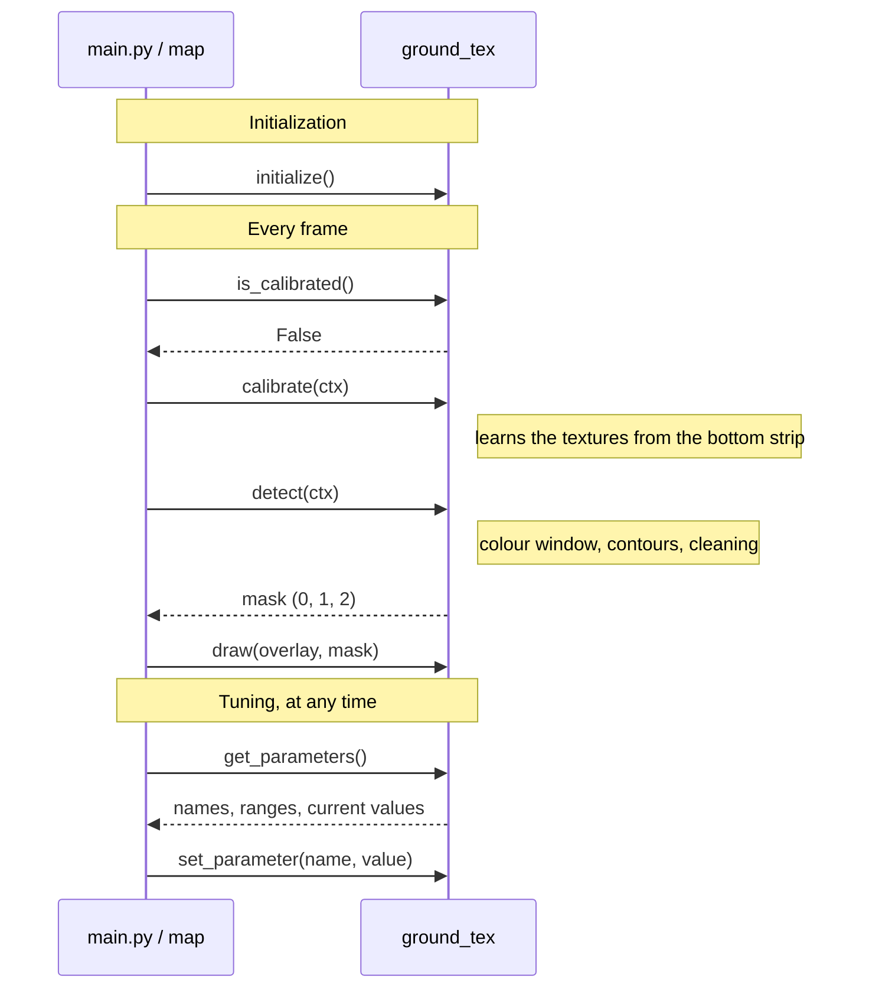

# SWS Ground Standard Texture (MID)

## 1 Introduction and functional overview

The `ground_standard_texture` module detects the ground in the image from its colour. At every frame it learns the colour of the floor in a strip at the bottom of the image, which is assumed to be floor, then marks as ground every pixel of the analysed area whose colour matches a learned texture. It returns a mask where each ground pixel carries the index of its texture, so that a floor and a rug can be told apart.

The mask is cleaned before it is returned: colour contours (the base of furniture, walls) are cut out, thin objects and isolated spots are removed, and only the regions connected to the bottom of the image are kept. The parameters of the module are global variables, adjustable at run time with `get_parameters`, `get_parameter` and `set_parameter`; there is one set of values per module.

## 2 Acronyms and Abbreviations

| Abbreviation / Acronym | Description |
| --- | --- |
| Texture | Colour model of one ground surface: mean and standard deviation of the pixels in HSV (hue, saturation, value). |
| Mask | `uint8` image of the frame size: 0 = not ground, 1, 2, ... = index (from 1) of the texture of the pixel. |
| Learning area | Strip at the bottom of the image used to learn the textures. |
| Analysed area | Part of the image, from a fraction of its height down to the bottom, where the ground is looked for. |
| `ctx` | `FrameContext`: `frame`, `gray` and `edges`, computed once per frame. |

## 3 Constraints and assumptions

- The learning area (bottom of the image) shows the floor and nothing else. *Why:* the textures are learned from it at every frame, without any other reference; an obstacle in the strip is learned as ground.
- The textures are relearned at every frame: `is_calibrated` always returns `False`. *Why:* the lighting changes while the robot moves, and a texture learned once would drift; the cost is low because only a small strip is processed.
- The camera is close to the floor and its height is known (`CAMERA_HEIGHT_M`). *Why:* the higher the camera, the lower the floor ends in the image, so the start of the analysed area follows the height; above it, the wall or the furniture would be taken for ground.
- The ground is recognised by its colour only, without depth or geometry. *Why:* an object of the same colour as the floor is part of the ground for this module; it is the job of the obstacle sources to detect it.
- `ctx.frame` is a BGR `uint8` image of shape `(height, width, 3)`. *Why:* the colour conversions (HSV, Lab) are made by the module itself.
- The module keeps the learned textures in a global variable and is not meant to be called from several threads. *Why:* two threads could learn and read the textures at the same time.

## 4 Dependencies to other modules

The module `ground_standard_texture` has interfaces and dependencies to the following modules:

### 4.1 Internal modules

| Module | Interface | Description |
| --- | --- | --- |
| `preprocessing` | `FrameContext` | `ctx.frame`: raw BGR frame. |
| `parameters` | `Parameter`, `describe`, `get_value`, `set_value` | Description, reading and checked writing of the adjustable parameters. |

### 4.2 External dependencies

| Library | Functions used | Description |
| --- | --- | --- |
| OpenCV (`cv2`) | `cvtColor`, `kmeans`, `GaussianBlur`, `Canny`, `morphologyEx`, `dilate`, `connectedComponents`, `connectedComponentsWithStats`, `addWeighted` | Colour conversions, clustering, contours, morphology, regions and drawing. |
| NumPy | `ndarray`, `interp`, `isin`, `bincount` | Arrays, interpolation of the analysed area and region selection. |

## 5 Functional specification

The module learns the textures of the floor from the bottom strip, marks the pixels of the analysed area that match a texture, cleans the result, and returns the mask.

### 5.1 Texture learning

**[SWS_GroundTexture_00001]** `calibrate` learns the textures from the learning area: the bottom `SAMPLE_BOTTOM_RATIO` of the image height, on a centred strip of `SAMPLE_WIDTH_RATIO` of the image width. The pixels are converted to HSV. A small strip at the bottom is the part of the floor that is the closest to the robot and the least likely to be hidden by an obstacle.

**[SWS_GroundTexture_00002]** The pixels of the learning area are split into at most `TEXTURE_COUNT_N` clusters by k-means on the weighted features (hue 2, saturation 1, value 0.5). A cluster that holds less than `MIN_CLUSTER_RATIO` of the pixels is ignored. Hue and saturation describe the surface and brightness mostly describes the lighting, so brightness weighs less. Ignoring small clusters avoids learning a texture from a few stray pixels.

**[SWS_GroundTexture_00003]** Each kept cluster gives a texture: the mean of its pixels in HSV and their standard deviation per channel, with a minimum standard deviation of (5, 15, 15). On a very uniform floor the deviation would be close to 0 and the colour window would reject the pixels of the same floor that differ slightly.

**[SWS_GroundTexture_00004]** If two textures are kept and the distance between their means is lower than `MERGE_DISTANCE_SIGMA`, they are one texture seen as two clusters and the model is replaced by a single texture learned from all the pixels. The distance is the largest, over the three channels, of `|mean1 - mean2| / (max(std1, std2) * tolerance)`, with a tolerance of 1 for hue and saturation and `V_TOLERANCE_FACTOR` for value. A uniform floor is often split in two by k-means, which would give two different values on the same surface.

**[SWS_GroundTexture_00005]** If no cluster is kept, or if the learning area has fewer pixels than `TEXTURE_COUNT_N`, a single texture is learned from all the pixels. The module always has at least one texture after `calibrate`.

### 5.2 Analysed area

**[SWS_GroundTexture_00010]** `detect` only analyses the image from the row `ratio * height` down to the bottom; above it the mask is 0. The ratio is interpolated linearly from `CAMERA_HEIGHT_M` between the points (0.12 m, 0.40) and (0.60 m, 0.60), and is constant outside these points. Measured on captures: the camera at 12 cm sees the floor from 40 % of the height, and at 60 cm from 60 %.

### 5.3 Detection

**[SWS_GroundTexture_00011]** For each texture, a pixel of the analysed area (in HSV) matches if, on every channel, `|pixel - mean| / (STD_FACTOR * tolerance * std) <= 1`, with a tolerance of 1 for hue and saturation and `V_TOLERANCE_FACTOR` for value. The window is wider on value because lighting varies more than colour.

**[SWS_GroundTexture_00012]** A pixel that matches several textures takes the nearest one (the smallest largest-channel distance). Its index is the index of the texture in the model, from 1, in the order of the clusters; it is not ordered by size or by position. A pixel that matches no texture is 0.

### 5.4 Mask cleaning

**[SWS_GroundTexture_00020]** A closing with a 5 x 5 kernel fills the small holes of the mask. Spots of a different colour inside the floor (a dust, a reflection) are not obstacles.

**[SWS_GroundTexture_00021]** The colour contours are cut out of the mask: the analysed area is smoothed (Gaussian blur of `EDGE_BLUR_SIZE_PX`), converted to Lab, and a Canny detection is made on each channel with the thresholds (10, 30) for L and (4, 12) for a and b. Only the contours that contain a horizontal or a vertical run of at least `EDGE_MIN_LENGTH_PX` pixels are kept; they are dilated by `EDGE_DILATE_SIZE_PX` and set to 0 in the mask. The smoothing makes the fine textures (rug) disappear while the long contours (base of the furniture, walls) stay, and the colour channels detect a change of surface even when the grey levels are close.

**[SWS_GroundTexture_00022]** An opening with a square kernel of `OPEN_KERNEL_SIZE_PX` removes the thin objects (legs) and the isolated spots.

**[SWS_GroundTexture_00023]** Only the regions connected to the bottom row of the image are kept. The ground is the part that continues from the learning area; a region that does not touch it is not reachable from where the floor is known.

**[SWS_GroundTexture_00024]** The holes enclosed in the kept regions are filled if they do not touch the border of the analysed area and if their area is at most `MAX_HOLE_AREA_PX2`. The pixels added by the closing or by the filling take the texture that is the most frequent among the kept pixels. Dark spots on the floor are not obstacles; a large hole may be one.

**[SWS_GroundTexture_00025]** `detect` returns a mask of the size of `ctx.frame`: 0 outside the analysed area, and the texture index, or 0, inside. If no texture has been learned (`calibrate` not called), the mask is entirely 0.

### 5.5 Parameters

**[SWS_GroundTexture_00030]** The parameters are global variables of the module, one set per module. Section 8.1 lists them; all can be changed at run time with `set_parameter`, and the new value is used from the next call of `calibrate` or `detect`. `get_parameters` lists them with their current value and `get_parameter` returns the current value of one of them.

**[SWS_GroundTexture_00031]** `set_parameter` refuses an unknown name, a value that is not a number of the type of the parameter (a boolean is refused), a value outside the range of section 8.1 and an even value for `EDGE_BLUR_SIZE_PX` (`GROUND_E_BAD_PARAMETER`); the parameter is then unchanged. The smoothing kernel must be odd, and a bad value would otherwise make OpenCV fail in the middle of a frame.

**[SWS_GroundTexture_00032]** The weights of the clustering, the minimum standard deviations, the Canny thresholds, the points of the analysed area and the colours of `draw` are internal constants of the module; they are not adjustable. They depend on the camera and the colour space rather than on the scene, and are not meant to be tuned.

### 5.6 Error classification

| Error code | Value [hex] | Type | Description |
| --- | --- | --- | --- |
| `GROUND_E_BAD_PARAMETER` | 0x01 | Development | Unknown parameter name, wrong type or value out of range given to `set_parameter` or `get_parameter`: `ValueError`. |

## 6 API specification

The module exposes the four common functions `initialize`, `calibrate`, `detect` and `draw`, plus `is_calibrated`, `get_parameters`, `get_parameter` and `set_parameter`.

### 6.1 Type definitions

The following Data Types shall be used for the functions defined in this specification.

**[SWS_GroundTexture_00050]** Type definitions of the module:

| Name | Kind | Range | Description |
| --- | --- | --- | --- |
| `GroundMask` | `numpy.ndarray`, `uint8`, shape `(height, width)` | 0 to `TEXTURE_COUNT_N` | Mask of SWS_GroundTexture_00025: 0 = not ground, `k` = texture `k`. |

### 6.2 Function definitions

This is a list of functions provided for upper layer modules.

#### 6.2.1 initialize

**[SWS_GroundTexture_00100]** Definition of `initialize`:

| Service name | `initialize` |
| --- | --- |
| Syntax | `initialize() -> None` |
| Sync/Async | Synchronous |
| Reentrancy | Non reentrant |
| Parameters (in) | None |
| Return value | None |
| Description | Prints the camera height and the start of the analysed area. The textures are learned by `calibrate`. |

#### 6.2.2 calibrate

**[SWS_GroundTexture_00101]** Definition of `calibrate`:

| Service name | `calibrate` |
| --- | --- |
| Syntax | `calibrate(ctx) -> None` |
| Sync/Async | Synchronous |
| Reentrancy | Non reentrant (writes the learned textures) |
| Parameters (in) | `ctx`: `FrameContext` of the current frame. |
| Return value | None |
| Description | Learns the textures (SWS_GroundTexture_00001 to 00005) and replaces the previous ones. |

#### 6.2.3 is_calibrated

**[SWS_GroundTexture_00102]** Definition of `is_calibrated`:

| Service name | `is_calibrated` |
| --- | --- |
| Syntax | `is_calibrated() -> bool` |
| Sync/Async | Synchronous |
| Reentrancy | Reentrant |
| Parameters (in) | None |
| Return value | Always `False`. |
| Description | The textures are relearned at every frame (section 3), so the callers (`main.py`, `map_standard_fusion`) call `calibrate` before each `detect`. |

#### 6.2.4 detect

**[SWS_GroundTexture_00103]** Definition of `detect`:

| Service name | `detect` |
| --- | --- |
| Syntax | `detect(ctx) -> GroundMask` |
| Sync/Async | Synchronous |
| Reentrancy | Non reentrant |
| Parameters (in) | `ctx`: `FrameContext` of the current frame. |
| Return value | The mask of SWS_GroundTexture_00025. |
| Description | Applies SWS_GroundTexture_00010 to 00025 with the textures of the last `calibrate` and the current values of the parameters. |

#### 6.2.5 draw

**[SWS_GroundTexture_00104]** Definition of `draw`:

| Service name | `draw` |
| --- | --- |
| Syntax | `draw(overlay, mask, colors=None, alpha=0.4) -> None` |
| Sync/Async | Synchronous |
| Reentrancy | Reentrant |
| Parameters (in) | `overlay`: BGR image, modified in place. `mask`: result of `detect`. `colors`: list of BGR colours, texture 1 first (default: green, cyan). `alpha`: opacity of the colours. |
| Return value | None |
| Description | Colours the pixels of each texture on `overlay`; a texture beyond the list reuses the colours in turn. |

#### 6.2.6 get_parameters

**[SWS_GroundTexture_00105]** Definition of `get_parameters`:

| Service name | `get_parameters` |
| --- | --- |
| Syntax | `get_parameters() -> list[dict]` |
| Sync/Async | Synchronous |
| Reentrancy | Reentrant |
| Parameters (in) | None |
| Return value | One `dict` per parameter of section 8.1, with the keys `name`, `type` (`"int"` or `"float"`), `minimum`, `maximum`, `unit`, `description` and `value` (current value). |
| Description | Describes the parameters for the HMI and for the tuning modules. |

#### 6.2.7 get_parameter

**[SWS_GroundTexture_00106]** Definition of `get_parameter`:

| Service name | `get_parameter` |
| --- | --- |
| Syntax | `get_parameter(name) -> int or float` |
| Sync/Async | Synchronous |
| Reentrancy | Reentrant |
| Parameters (in) | `name`: name of a parameter of section 8.1. |
| Return value | Current value of the parameter. |
| Description | Raises `ValueError` (`GROUND_E_BAD_PARAMETER`) for an unknown name. |

#### 6.2.8 set_parameter

**[SWS_GroundTexture_00107]** Definition of `set_parameter`:

| Service name | `set_parameter` |
| --- | --- |
| Syntax | `set_parameter(name, value) -> None` |
| Sync/Async | Synchronous |
| Reentrancy | Non reentrant (writes a global variable) |
| Parameters (in) | `name`: name of a parameter of section 8.1. `value`: new value, of the type and in the range of section 8.1. |
| Return value | None |
| Description | Applies SWS_GroundTexture_00031 and stores the value; it is used from the next call of `calibrate` or `detect`. |

## 7 Sequence diagrams

Every frame learns the textures again, then detects the ground with them.

## 8 Configuration specification

The parameters are global variables at the top of `ground_standard_texture.py`. There is one set of values per module.

### 8.1 Parameters adjustable at run time

Available through `get_parameters`, `get_parameter` and `set_parameter`; a new value is used from the next call of `calibrate` or `detect`.

| Parameter name | Type | Range | Default | Unit | Description |
| --- | --- | --- | --- | --- | --- |
| `CAMERA_HEIGHT_M` | float | [0, 2] | 0.12 | m | Height of the camera above the floor; sets the start of the analysed area (SWS_GroundTexture_00010). |
| `SAMPLE_BOTTOM_RATIO` | float | [0.01, 1] | 0.12 | ratio | Height of the learning area at the bottom of the image, as a share of the image height. |
| `SAMPLE_WIDTH_RATIO` | float | [0.05, 1] | 1 | ratio | Width of the learning area, centred, as a share of the image width. |
| `TEXTURE_COUNT_N` | int | [1, 2] | 2 | count | Number of textures looked for in the learning area (for example floor and rug). |
| `MIN_CLUSTER_RATIO` | float | [0, 0.5] | 0.1 | ratio | Smallest share of the learning area for a texture to be kept. |
| `MERGE_DISTANCE_SIGMA` | float | [0, 10] | 2 | sigma | Distance, in standard deviations, under which two textures are merged into one. |
| `STD_FACTOR` | float | [0.5, 6] | 2 | factor | Width of the colour window of a texture, in standard deviations. |
| `V_TOLERANCE_FACTOR` | float | [1, 5] | 1.5 | factor | Extra tolerance on the brightness channel (V) compared with hue and saturation. |
| `OPEN_KERNEL_SIZE_PX` | int | [1, 51] | 9 | px | Side of the opening that removes thin objects and isolated spots. |
| `EDGE_DILATE_SIZE_PX` | int | [1, 31] | 3 | px | Thickness of the colour contours that are cut out of the mask. |
| `EDGE_BLUR_SIZE_PX` | int | [1, 31] | 9 | px | Side of the smoothing before the contour detection; must be odd. |
| `EDGE_MIN_LENGTH_PX` | int | [1, 200] | 25 | px | Shortest colour contour that is kept (horizontal or vertical run). |
| `MAX_HOLE_AREA_PX2` | int | [0, 100000] | 400 | px² | Largest enclosed hole in the ground that is filled. |

### 8.2 Parameters that require `initialize`

None.
