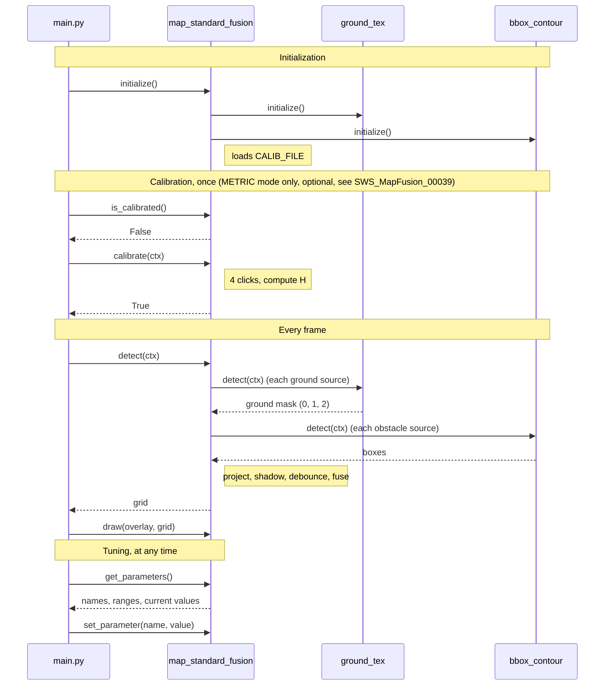

# SWS Map Standard Fusion (MID)

## 1 Introduction and functional overview

The `map_standard_fusion` module builds a 2D occupancy grid from a single camera: it fuses ground sources (today `ground_standard_texture`) with obstacle sources (today `bbox_standard_contour`), and expresses the result in one of two geometries selected by `MAP_MODE`: **PIXEL** (default), cells are blocks of the camera image and no calibration is needed; **METRIC** (optional), cells are squares on the ground around the robot, through a calibrated homography. Other models can be added to either list later.

Each grid cell is **free**, **free on another surface**, **obstacle** or **unknown**. A ground texture means ground, hence no obstacle; the reference texture gives *free* and any other texture gives *free on another surface* (for example a rug on a wooden floor). A box means an obstacle. The map is recomputed on every frame, with no robot pose and no memory other than a per-cell debounce counter that avoids flickering; it is displayed in the lower-left view of the 2 × 2 OpenCV HMI. In PIXEL mode the map is the camera view in blocks: it is distorted by the perspective and gives no distance in meters.

## 2 Acronyms and Abbreviations

| Abbreviation / Acronym | Description |
| --- | --- |
| ROI | Region of Interest: the part of the image that is analyzed |
| H | 3×3 homography that maps image pixels of the ground to meters |
| `ctx` | `FrameContext`: `frame`, `gray` and `edges`, computed once per frame |

## 3 Constraints and assumptions

The map is only valid if the following assumptions hold; otherwise it is wrong and the module cannot detect it. The first two assumptions only concern the METRIC mode.

- The ground is flat between the robot and the far edge of the grid. *Why:* `H` maps a plane to a plane; a slope or a step gives a wrong distance for everything beyond it.
- The camera is fixed relative to the robot: its height and tilt have not changed since the calibration. *Why:* `H` is valid for one camera pose only; any change moves the ground points in the image.
- There is a single camera and no depth measurement. The map is local and recomputed on every frame, without robot pose. *Why:* nothing can be accumulated without a pose; the debounce of 5.3 only smooths detections over a few frames. In PIXEL mode, what is hidden behind an obstacle is assumed to be the part of the image above its bottom edge.
- A ground source returns a mask of the image size: 0 = no information, 1 = reference surface, ≥ 2 = another surface. *Why:* any model giving this mask can be a source. `ground_tex` only covers the lower part of the image (ROI from 40 % of the height for a camera 12 cm above the floor, up to 60 % at 60 cm, following its parameter `CAMERA_HEIGHT_M`); elsewhere it gives 0.
- `bbox_contour` returns pixel rectangles `(x1, y1, x2, y2)` computed with its own parameters (one set per module, shared with the other callers), and the bottom edge of a box is the contact with the ground. *Why:* the bottom edge is the only point of a box known to touch the floor. It holds with `SCALE_RATIO = 1.0` (default of `bbox_contour`); a larger value moves the bottom edge down.

## 4 Dependencies to other modules

The module `map_standard_fusion` has interfaces and dependencies to the following modules:

### 4.1 Internal modules

| Module | Interface | Description |
| --- | --- | --- |
| `ground_standard_texture` (`ground_tex`) | `is_calibrated()`, `calibrate(ctx)`, `detect(ctx)` | Ground source. Mask: `uint8` array of the image size, 0 = no ground, 1 = texture 1 (reference surface), 2 = texture 2 (another surface). The textures are learned from the bottom of the frame (2 clusters, merged if too close). The mask is the region of the texture colours that is connected to the bottom of the image and delimited by the colour contours. The module relearns them at every frame while `is_calibrated()` returns `False`. |
| `bbox_standard_contour` (`bbox_contour`) | `detect(ctx)` | Obstacle source. List of `(x1, y1, x2, y2)` pixel rectangles. |
| `preprocessing` | `FrameContext` | `frame`, `gray` and `edges`, computed once per frame. |

### 4.2 External dependencies

| Library | Functions used | Description |
| --- | --- | --- |
| OpenCV (`cv2`) | `getPerspectiveTransform`, `warpPerspective`, `perspectiveTransform`, `blur`, `clipLine`, `line`, `fillPoly`, `setMouseCallback` | Homography, projection, shadow polygons and calibration input. |
| NumPy | `ndarray` (`uint8`) | Storage of the grid and of the masks. |

## 5 Functional specification

In both modes, a cell is an obstacle if a box covers it, unknown if it is hidden behind an obstacle, free (reference surface) or free on another surface if a ground texture covers it, and unknown otherwise. In METRIC mode, the homography from the 4-point calibration gives the pixel-to-meter equivalence.

### 5.1 Grid model

**[SWS_MapFusion_00001]** The grid is a `uint8` array of `N_ROWS × N_COLS` cells. In METRIC mode, `N_COLS = GRID_WIDTH_M / CELL_SIZE_M` and `N_ROWS = GRID_DEPTH_M / CELL_SIZE_M`. In PIXEL mode, `N_COLS = ceil(image width / CELL_SIZE_PX)` and `N_ROWS = ceil(image height / CELL_SIZE_PX)`; they follow the frame size. Values: `UNKNOWN = 0`, `FREE = 1`, `OBSTACLE = 2`, `FREE_OTHER_SURFACE = 3`. In PIXEL mode the grid follows the frame size, so no calibration is needed; in METRIC mode the physical size of the area around the robot fixes it.

**[SWS_MapFusion_00002]** In METRIC mode, the robot frame has its origin at the ground point below the camera, the x axis to the right and the y axis forward, in meters. The grid covers x in `[-GRID_WIDTH_M/2, +GRID_WIDTH_M/2]` and y in `[0, GRID_DEPTH_M]`. In PIXEL mode, cell `(row, column)` covers the pixels `[row * CELL_SIZE_PX, (row + 1) * CELL_SIZE_PX[` by `[column * CELL_SIZE_PX, (column + 1) * CELL_SIZE_PX[`.

**[SWS_MapFusion_00003]** Row 0 of the grid is the farthest from the robot (METRIC) or the top of the image (PIXEL), and column 0 is on the left, so the robot (the camera in PIXEL mode) is at the bottom centre when the grid is displayed.

**[SWS_MapFusion_00004]** Each call of `detect` starts from a grid where every cell is `UNKNOWN`. The map is a function of the current detections only (and of the debounce counters); keeping the previous grid would need the robot pose.

### 5.2 Source interpretation

**[SWS_MapFusion_00010]** A ground mask pixel with a value `> 0` means ground, hence no obstacle at that place: value 1 is the reference surface and any value `>= 2` is another surface. Both modes use the same pipeline: the share of pixels of each surface is warped into the grid with `cv2.warpPerspective` and the pixel-to-cell matrix (`H` followed by the scaling of SWS_MapFusion_00033). In PIXEL mode, `H` is the identity (ratio 1), the scaling is `1 / CELL_SIZE_PX`, and the shares are first averaged over `CELL_SIZE_PX` pixels. A cell is ground if the shares of the two surfaces add up to at least `GROUND_COVERAGE_RATIO`, and takes the surface with the larger share. A cell whose surface is 1 is a `FREE` candidate, and a cell whose surface is `>= 2` is a `FREE_OTHER_SURFACE` candidate. One pipeline for both modes avoids two code paths: PIXEL mode is a homography of ratio 1 followed by a scaling.

**[SWS_MapFusion_00011]** A ground mask pixel equal to 0, or outside the camera field of view, brings no information: the cell stays `UNKNOWN`.

**[SWS_MapFusion_00012]** For each box `(x1, y1, x2, y2)`, the segment `(x1, y2)` to `(x2, y2)` (bottom edge, contact with the ground) gives the `OBSTACLE` candidates, thickened by `OBSTACLE_MARGIN_CELLS` cells. The segment is projected with `cv2.perspectiveTransform` and the pixel-to-cell matrix of SWS_MapFusion_00010 (the identity-based one in PIXEL mode), then drawn in the grid. Only the bottom edge of a box touches the floor; the rest of the box is above it and would be projected at a wrong place.

**[SWS_MapFusion_00013]** A box whose projected segment lies entirely outside the grid is ignored. A box outside the grid cannot change any cell.

**[SWS_MapFusion_00014]** The sources are listed in the configuration (`GROUND_SOURCES`, `OBSTACLE_SOURCES`) as (module, keyword arguments of `detect`, name of the debounce parameter, fast attack). A ground source returns the mask of section 3 and an obstacle source returns boxes as in SWS_MapFusion_00012. Adding a model means appending it to the list; the fusion rules do not change.

**[SWS_MapFusion_00015]** When several ground sources cover the same cell, the reference surface (1) wins over another surface (`>= 2`). The reference surface is the one the robot has learned and stands on, so it is the most reliable.

### 5.3 Fusion

**[SWS_MapFusion_00020]** The fusion gives each cell the state of the first matching condition in this table:

| Priority | Condition | Cell state |
| --- | --- | --- |
| 1 | The cell is on the contact segment of a box (margin included). | `OBSTACLE` |
| 2 | The cell is in the shadow of a box (SWS_MapFusion_00021). | `UNKNOWN` |
| 3 | A ground source covers the cell with the reference surface (1). | `FREE` |
| 4 | A ground source covers the cell with another surface (`>= 2`). | `FREE_OTHER_SURFACE` |
| 5 | None of the above. | `UNKNOWN` |

**[SWS_MapFusion_00021]** Whatever is hidden is `UNKNOWN` for safety. In METRIC mode, the shadow of a box is the region behind its projected contact segment: the cells farther from the robot origin than the segment, within the angle that the two segment ends span as seen from the origin. It is the polygon made of the two segment ends and their extensions along the rays from the origin to the grid border. In PIXEL mode, the shadow is the set of cells above the contact row (and its margin), between the columns of the box. What is behind an obstacle cannot be seen: saying free or occupied would be a guess, and unknown is the safe state for navigation.

**[SWS_MapFusion_00022]** The absence of a box is never information: it does not make a cell free. The box detector misses low-contrast objects, so no box does not mean an empty floor; a cell is free only if a ground texture says so.

**[SWS_MapFusion_00023]** The only temporal memory is the debounce of SWS_MapFusion_00025 to 00028. There is no robot pose and no accumulation of the map: with `N = 1`, two successive frames give two independent maps.

**[SWS_MapFusion_00025]** Each source has, for every cell of the grid, one counter `c` in `[0, N]` and a boolean `detected`, initially 0 and `False`. A source gives a detection for a cell (the cell is covered by a ground texture, or by a box or a shadow) or no detection. `N` is a parameter of the source (`DEBOUNCE_GROUND_N`, `DEBOUNCE_OBSTACLE_N`).

**[SWS_MapFusion_00026]** At every frame, `c` is increased by `up` on a detection and decreased by `down` on a missing detection, and limited to `[0, N]`. A source has either a fast attack (`up = N`, `down = max(N/3, 1)`) or a slow attack (`up = max(N/3, 1)`, `down = N`). Ground sources have a fast attack (detected at once, lost after about 3 frames); obstacle sources have a slow attack (detected after about 3 frames, lost at once). With `N = 3`, the ground sources use `+3` and `-1`. `N = 1` disables the debounce. A false obstacle blocks the robot for no reason, so an obstacle needs several consistent frames, but it disappears at once so that no ghost stays on the path; the ground flickers with the light, so it is the opposite.

**[SWS_MapFusion_00027]** `detected` changes to `True` when `c` reaches `N`, and to `False` when `c` reaches 0. The counter is then on the bound of the new state and is not changed by the change of state.

**[SWS_MapFusion_00028]** The fusion of 5.3 only uses the debounced result: a cell where `detected` is `True` keeps the last detection seen (the surface 1 or 2 of a ground source, the obstacle or the shadow of an obstacle source), and a cell where `detected` is `False` brings no information. The counters are reset when the grid size changes and at `initialize`. The granularity is the cell of the grid (`CELL_SIZE_PX` or `CELL_SIZE_M`).

**[SWS_MapFusion_00024]** A ground texture only says that the floor is visible at that place. It never cancels an obstacle: the box that stands on it keeps priority 1, and the cells hidden behind it stay `UNKNOWN` even if a texture covers them. A texture can cover the foot of a piece of furniture of nearly the same colour as the floor; the box is the stronger evidence.

### 5.4 Pixel-to-meter calibration (METRIC mode only)

The calibration is only used in METRIC mode, which is optional. In PIXEL mode `is_calibrated` returns `True`, `calibrate` returns `False` (`MAP_E_WRONG_MODE`) and the three helper functions return `None`.

**[SWS_MapFusion_00030]** The calibration computes the homography `H` (3×3) that maps a ground pixel to meters in the robot frame, from 4 correspondences between image points and ground points.

**[SWS_MapFusion_00031]** Procedure: lay a rectangle of `CALIB_RECT_WIDTH_M × CALIB_RECT_DEPTH_M` on the floor, centred laterally, with its near edge at `CALIB_RECT_NEAR_M` from the robot. On the frozen image, the operator clicks the 4 corners in this order: near left, near right, far right, far left.

**[SWS_MapFusion_00032]** The matching ground points, in meters, are `(-W/2, d)`, `(+W/2, d)`, `(+W/2, d+L)`, `(-W/2, d+L)`, with `W = CALIB_RECT_WIDTH_M`, `L = CALIB_RECT_DEPTH_M` and `d = CALIB_RECT_NEAR_M`.

**[SWS_MapFusion_00033]** `H = cv2.getPerspectiveTransform(image_points, ground_points)`. The grid projection is `H` followed by a fixed scaling from meters to cell indices: `column = (x + GRID_WIDTH_M/2) / CELL_SIZE_M` and `row = (GRID_DEPTH_M - y) / CELL_SIZE_M`. One fixed scaling after `H` gives the cell index directly and has the same form as in PIXEL mode (SWS_MapFusion_00010).

**[SWS_MapFusion_00034]** The input is an OpenCV window: left click adds a point, `r` restarts, Enter validates, Esc cancels.

**[SWS_MapFusion_00035]** After validation, the module overlays a metric grid (one line every `DRAW_GRID_STEP_M`) on the image for visual control. An optional 5th click on the centre of the rectangle shows the position error in centimeters.

**[SWS_MapFusion_00036]** After validation, the module shows the ground resolution in centimeters per pixel at 1 m, 2 m and 3 m. It is not uniform and degrades with distance.

**[SWS_MapFusion_00037]** `H` is saved in `CALIB_FILE` (JSON: image points, ground points, `H`, image resolution, date). `initialize` reloads it; the image resolution is compared with the first frame given to `detect`, and a different resolution discards the file (`MAP_E_CALIB_FILE`).

**[SWS_MapFusion_00038]** Any change of camera height or tilt invalidates `H`: a new calibration is required. `H` is valid for one camera pose only.

**[SWS_MapFusion_00039]** The calibration is interactive and blocks the HMI, so `main.py` can disable its automatic start (`NO_AUTO_CALIBRATION`): the grid is then entirely `UNKNOWN` unless `CALIB_FILE` exists. When it is started automatically, it is requested only once, even if cancelled (`CALIBRATION_ASKED_ONCE`). The calibration waits for mouse clicks and would freeze the video loop if it was started at each frame.

### 5.5 Parameters

**[SWS_MapFusion_00040]** The parameters are global variables of the module, one set per module. Section 8.1 lists those that can be changed at run time with `set_parameter`; the new value is used from the next call of `detect` (or `draw`). `get_parameters` lists them with their current value and `get_parameter` returns the current value of one of them.

**[SWS_MapFusion_00041]** Changing `DEBOUNCE_GROUND_N` or `DEBOUNCE_OBSTACLE_N` restarts the counters of every source. The counters depend on `N`; keeping them would mix the old and the new steps.

**[SWS_MapFusion_00042]** The parameters of section 8.2 define the geometry of the grid and the calibration: they are read by `initialize` and cannot be changed with `set_parameter`. To change one, modify the global variable and call `initialize` again. The grid size, the mode and the calibration shape the grid and the matrices, which are built once at `initialize`.

**[SWS_MapFusion_00043]** `set_parameter` refuses an unknown name, a value that is not a number of the type of the parameter (a boolean is refused) and a value outside the range of section 8.1 (`MAP_E_BAD_PARAMETER`); the parameter is then unchanged.

### 5.6 Error classification

| Error code | Value [hex] | Type | Description |
| --- | --- | --- | --- |
| `MAP_E_NOT_INITIALIZED` | 0x01 | Development | `detect` or `calibrate` called before `initialize`: `RuntimeError`. |
| `MAP_E_NOT_CALIBRATED` | 0x02 | Runtime | METRIC mode only: `detect` without calibration: every cell is `UNKNOWN`, and a warning is printed once. |
| `MAP_E_CALIB_ABORTED` | 0x03 | Runtime | Esc during the calibration: `calibrate` returns `False` and the previous state is kept. |
| `MAP_E_CALIB_FILE` | 0x04 | Runtime | `CALIB_FILE` unreadable, or made for a different resolution (detected at `detect`): ignored, the module stays uncalibrated. A missing file is not an error. |
| `MAP_E_WRONG_MODE` | 0x06 | Runtime | `calibrate` called in PIXEL mode: nothing is done, `False` is returned and a message is printed. |
| `MAP_E_BAD_FRAME` | 0x05 | Development | `ctx.frame` empty, or of a different resolution than a calibration made in the session: `ValueError`. |
| `MAP_E_BAD_PARAMETER` | 0x07 | Development | Unknown name, wrong type or value out of range given to `set_parameter` or `get_parameter`: `ValueError`. |

## 6 API specification

The module exposes the four common functions `initialize`, `calibrate`, `detect` and `draw`, plus `get_parameters`, `get_parameter` and `set_parameter`, and three helper functions for the pixel-to-meter equivalence (METRIC mode).

### 6.1 Type definitions

The following Data Types shall be used for the functions defined in this specification.

**[SWS_MapFusion_00050]** Type definitions of the module:

| Name | Kind | Range | Description |
| --- | --- | --- | --- |
| `CellState` | `IntEnum` | `UNKNOWN = 0`, `FREE = 1`, `OBSTACLE = 2`, `FREE_OTHER_SURFACE = 3` | State of a grid cell. |
| `Grid` | `numpy.ndarray`, `uint8` | shape `(N_ROWS, N_COLS)`, values of `CellState` | Occupancy grid, robot (or camera) at the bottom centre. |

### 6.2 Function definitions

This is a list of functions provided for upper layer modules.

#### 6.2.1 initialize

**[SWS_MapFusion_00100]** Definition of `initialize`:

| Service name | `initialize` |
| --- | --- |
| Syntax | `initialize() -> None` |
| Sync/Async | Synchronous |
| Reentrancy | Non reentrant |
| Parameters (in) | None |
| Return value | None |
| Description | Initializes the ground and obstacle sources. In METRIC mode, computes `N_ROWS` and `N_COLS` and loads `CALIB_FILE` if it exists (SWS_MapFusion_00037). Raises `ValueError` if `MAP_MODE` is unknown. Must be called once before any other function. |

#### 6.2.2 calibrate

**[SWS_MapFusion_00101]** Definition of `calibrate`:

| Service name | `calibrate` |
| --- | --- |
| Syntax | `calibrate(ctx=None) -> bool` |
| Sync/Async | Synchronous (blocks until the operator validates or cancels) |
| Reentrancy | Non reentrant |
| Parameters (in) | `ctx`: `FrameContext` whose `ctx.frame` is frozen for the selection of the 4 points. If `None`, the module grabs one image from the camera itself. |
| Return value | `True` if the calibration is validated and saved; `False` if cancelled (`MAP_E_CALIB_ABORTED`) or in PIXEL mode (`MAP_E_WRONG_MODE`). |
| Description | Interactive procedure of 5.4. Called by `main.py` unless the automatic start is disabled (SWS_MapFusion_00039). |

#### 6.2.3 is_calibrated

**[SWS_MapFusion_00102]** Definition of `is_calibrated`:

| Service name | `is_calibrated` |
| --- | --- |
| Syntax | `is_calibrated() -> bool` |
| Sync/Async | Synchronous |
| Reentrancy | Reentrant |
| Parameters (in) | None |
| Return value | `True` in PIXEL mode; in METRIC mode, `True` if `H` is available. |
| Description | Tells whether the map can be built. |

#### 6.2.4 detect

**[SWS_MapFusion_00103]** Definition of `detect`:

| Service name | `detect` |
| --- | --- |
| Syntax | `detect(ctx) -> Grid` |
| Sync/Async | Synchronous |
| Reentrancy | Non reentrant |
| Parameters (in) | `ctx`: `FrameContext` of the current frame. |
| Return value | The fused grid of 5.3; in METRIC mode, every cell is `UNKNOWN` if the module is not calibrated. |
| Description | For each ground source, calls `calibrate(ctx)` if its `is_calibrated()` is `False`, then `detect(ctx)`; for each obstacle source, calls `detect(ctx)`. Converts the results into cells (5.2), applies the shadow rule and fuses (5.3). |

#### 6.2.5 draw

**[SWS_MapFusion_00104]** Definition of `draw`:

| Service name | `draw` |
| --- | --- |
| Syntax | `draw(overlay, grid) -> None` |
| Sync/Async | Synchronous |
| Reentrancy | Non reentrant |
| Parameters (in) | `overlay`: BGR image of the view. `grid`: result of `detect`. |
| Return value | None |
| Description | Replaces the content of `overlay` with the grid scaled to the view (nearest neighbour, aspect ratio kept, black bands). `UNKNOWN` is gray, `FREE` green, `FREE_OTHER_SURFACE` cyan and `OBSTACLE` red; in METRIC mode, ticks every `DRAW_GRID_STEP_M`; robot at the bottom centre. The view keeps the size of the other views, which `cv2.hconcat` requires. |

#### 6.2.6 get_parameters

**[SWS_MapFusion_00108]** Definition of `get_parameters`:

| Service name | `get_parameters` |
| --- | --- |
| Syntax | `get_parameters() -> list[dict]` |
| Sync/Async | Synchronous |
| Reentrancy | Reentrant |
| Parameters (in) | None |
| Return value | One `dict` per parameter of section 8.1, with the keys `name`, `type` (`"int"` or `"float"`), `minimum`, `maximum`, `unit`, `description` and `value` (current value). |
| Description | Describes the parameters adjustable at run time, for the HMI and for `bbox_standard_tuning`. |

#### 6.2.7 get_parameter

**[SWS_MapFusion_00109]** Definition of `get_parameter`:

| Service name | `get_parameter` |
| --- | --- |
| Syntax | `get_parameter(name) -> int or float` |
| Sync/Async | Synchronous |
| Reentrancy | Reentrant |
| Parameters (in) | `name`: name of a parameter of section 8.1. |
| Return value | Current value of the parameter. |
| Description | Raises `ValueError` (`MAP_E_BAD_PARAMETER`) for an unknown name. |

#### 6.2.8 set_parameter

**[SWS_MapFusion_00110]** Definition of `set_parameter`:

| Service name | `set_parameter` |
| --- | --- |
| Syntax | `set_parameter(name, value) -> None` |
| Sync/Async | Synchronous |
| Reentrancy | Non reentrant (writes a global variable) |
| Parameters (in) | `name`: name of a parameter of section 8.1. `value`: new value, of the type and in the range of section 8.1. |
| Return value | None |
| Description | Applies SWS_MapFusion_00043, stores the value, and restarts the counters if the parameter is a debounce `N` (SWS_MapFusion_00041). |

#### 6.2.9 pixel_to_ground

**[SWS_MapFusion_00105]** Definition of `pixel_to_ground`:

| Service name | `pixel_to_ground` |
| --- | --- |
| Syntax | `pixel_to_ground(u, v) -> tuple[float, float] \| None` |
| Sync/Async | Synchronous |
| Reentrancy | Reentrant |
| Parameters (in) | `u`, `v`: pixel column and row. |
| Return value | `(x, y)` in meters in the robot frame, or `None` if not calibrated (always in PIXEL mode). |
| Description | Ground position of the pixel `(u, v)`; valid for a pixel that touches the ground (flat ground, section 3). |

#### 6.2.10 ground_to_pixel

**[SWS_MapFusion_00106]** Definition of `ground_to_pixel`:

| Service name | `ground_to_pixel` |
| --- | --- |
| Syntax | `ground_to_pixel(x, y) -> tuple[int, int] \| None` |
| Sync/Async | Synchronous |
| Reentrancy | Reentrant |
| Parameters (in) | `x`, `y`: position in meters in the robot frame. |
| Return value | The pixel `(u, v)`, or `None` if not calibrated (always in PIXEL mode). |
| Description | Inverse transformation (inverse of `H`); used to draw the metric control grid (SWS_MapFusion_00035). |

#### 6.2.11 ground_resolution

**[SWS_MapFusion_00107]** Definition of `ground_resolution`:

| Service name | `ground_resolution` |
| --- | --- |
| Syntax | `ground_resolution(u, v) -> tuple[float, float] \| None` |
| Sync/Async | Synchronous |
| Reentrancy | Reentrant |
| Parameters (in) | `u`, `v`: pixel column and row. |
| Return value | `(dx, dy)` in meters per pixel, or `None` if not calibrated (always in PIXEL mode). |
| Description | Ground size of one pixel at `(u, v)`, computed with `pixel_to_ground` on two neighbouring pixels; used by SWS_MapFusion_00036. |

## 7 Sequence diagrams

Initialization loads the calibration file if it exists; `main.py` may run `calibrate` once, then every frame calls `detect` and `draw`.

## 8 Configuration specification

The parameters are global variables at the top of `map_standard_fusion.py`, one set per module. In METRIC mode the defaults give a grid of 80 × 80 cells; adjust them to what the camera really sees.

### 8.1 Parameters adjustable at run time

Available through `get_parameters`, `get_parameter` and `set_parameter`; a new value is used from the next call of `detect` or `draw`.

| Parameter name | Type | Range | Default | Unit | Description |
| --- | --- | --- | --- | --- | --- |
| `GROUND_COVERAGE_RATIO` | float | [0, 1] | 0.5 | ratio | PIXEL mode: share of ground pixels that makes a cell ground. |
| `OBSTACLE_MARGIN_CELLS` | int | [0, 10] | 1 | cells | Thickness added around the contact segment of a box, in cells. |
| `DEBOUNCE_GROUND_N` | int | [1, 100] | 3 | frames | `N` of the ground sources (fast attack, SWS_MapFusion_00026), in frames; 1 disables the debounce. |
| `DEBOUNCE_OBSTACLE_N` | int | [1, 100] | 3 | frames | `N` of the obstacle sources (slow attack), in frames; 1 disables the debounce. |
| `DRAW_GRID_STEP_M` | float | [0.05, 5] | 0.5 | m | Spacing of the ticks in the view and of the control grid, in meters. |

### 8.2 Parameters that require `initialize`

| Parameter name | Type | Range | Default | Unit | Description |
| --- | --- | --- | --- | --- | --- |
| `MAP_MODE` | str | `"PIXEL"`, `"METRIC"` | `"PIXEL"` | – | Geometry of the grid. `"METRIC"` needs the calibration. |
| `CELL_SIZE_PX` | int | > 0 | 16 | px | PIXEL mode: side of one cell, in pixels. |
| `GRID_WIDTH_M` | float | > 0 | 4.0 | m | METRIC mode: grid width, in meters. |
| `GRID_DEPTH_M` | float | > 0 | 4.0 | m | METRIC mode: grid depth in front of the robot, in meters. |
| `CELL_SIZE_M` | float | > 0 | 0.05 | m | METRIC mode: side of one cell, in meters. |
| `CALIB_RECT_WIDTH_M` | float | > 0 | 0.40 | m | Width of the rectangle laid on the floor for the calibration. |
| `CALIB_RECT_DEPTH_M` | float | > 0 | 0.60 | m | Depth of that rectangle. |
| `CALIB_RECT_NEAR_M` | float | ≥ 0 | 0.30 | m | Distance between the robot and the near edge of the rectangle. |
| `CALIB_FILE` | str | file path | `map_calibration.json` | – | File where `H` is saved. |
| `GROUND_SOURCES` | list of (module, dict, str, bool) | ground sources (section 3) | `[(ground_tex, {}, "DEBOUNCE_GROUND_N", True)]` | – | Models giving the ground: module, keyword arguments of `detect`, name of the debounce parameter, fast attack. |
| `OBSTACLE_SOURCES` | list of (module, dict, str, bool) | obstacle sources | `[(bbox_contour, {}, "DEBOUNCE_OBSTACLE_N", False)]` | – | Models giving obstacle boxes, with the same fields. |
