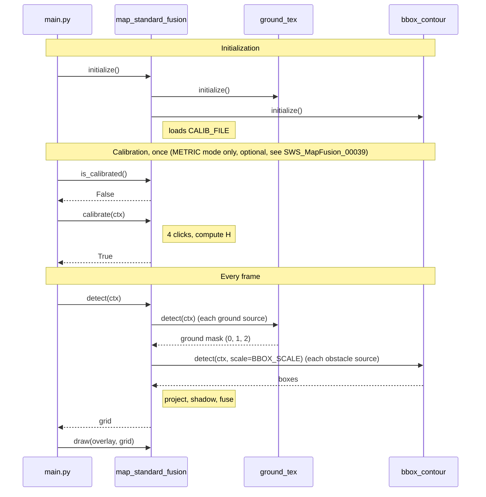

# SWS Map Standard Fusion (MID)

Module: `map_standard_fusion.py` · Status: draft 0.3 · Date: 2026-11-12

## 1 Introduction and functional overview

The `map_standard_fusion` module builds a 2D occupancy grid from a single camera: it fuses ground sources (today `ground_standard_texture`) with obstacle sources (today `bbox_standard_contour`), and expresses the result in one of two geometries selected by `MAP_MODE`: **PIXEL** (default), cells are blocks of the camera image and no calibration is needed; **METRIC** (optional), cells are squares on the ground around the robot, through a calibrated homography. Other models can be added to either list later.

Each grid cell is **free**, **free on another surface**, **obstacle** or **unknown**. A ground texture means ground, hence no obstacle; the reference texture gives *free* and any other texture gives *free on another surface* (for example a rug on a wooden floor). A box means an obstacle. The map is recomputed on every frame, with no memory and no robot pose; it is displayed in the lower-left view of the 2 × 2 OpenCV HMI. In PIXEL mode the map is the camera view in blocks: it is distorted by the perspective and gives no distance in meters.

Out of scope for this version: a map accumulated over time, robot pose, depth estimation, object tracking and sending the map to the robot.

## 2 Acronyms and Abbreviations

| Abbreviation / Acronym | Description |
| --- | --- |
| ROI | Region of Interest: the part of the image that is analyzed |
| H | 3×3 homography that maps image pixels of the ground to meters |
| `ctx` | `FrameContext`: `frame`, `gray` and `edges`, computed once per frame |

## 3 Constraints and assumptions

The map is only valid if the following assumptions hold; otherwise it is wrong and the module cannot detect it. A1 and A2 only concern the METRIC mode.

| ID | Assumption |
| --- | --- |
| A1 | The ground is flat between the robot and the far edge of the grid. |
| A2 | The camera is fixed relative to the robot: its height and tilt have not changed since the calibration. |
| A3 | There is a single camera and no depth measurement. The map is local and recomputed on every frame, without robot pose. In PIXEL mode, what is hidden behind an obstacle is assumed to be the part of the image above its bottom edge. |
| A4 | A ground source returns a mask of the image size: 0 = no information, 1 = reference surface, ≥ 2 = another surface. `ground_tex` only covers the lower part of the image (ROI from 60 % to 100 % of the height); elsewhere it is 0. |
| A5 | `bbox_contour` returns pixel rectangles `(x1, y1, x2, y2)`. The map requests them without enlargement (`scale = 1.0`), so the bottom edge of a box is the contact with the ground. |
| A6 | Python with OpenCV and NumPy only; no TensorFlow in this module. |

## 4 Dependencies to other modules

`map_standard_fusion` does not need any result precomputed by `main.py`; it calls the modules below itself.

### 4.1 Internal modules

| Module | Interface | Description |
| --- | --- | --- |
| `ground_standard_texture` (`ground_tex`) | `is_calibrated()`, `calibrate(ctx)`, `detect(ctx)` | Ground source. Mask: `uint8` array of the image size, 0 = no ground, 1 = texture 1 (reference surface), 2 = texture 2 (another surface). The textures are learned from the bottom of the frame (2 clusters, merged if too close). The module relearns them at every frame while `is_calibrated()` returns `False`. |
| `bbox_standard_contour` (`bbox_contour`) | `detect(ctx, scale=1.0)` | Obstacle source. List of `(x1, y1, x2, y2)` pixel rectangles. `scale = 1.0` disables the enlargement. |
| `preprocessing` | `FrameContext` | `frame`, `gray` and `edges`, computed once per frame. |

### 4.2 External dependencies

| Library | Functions used | Description |
| --- | --- | --- |
| OpenCV (`cv2`) | `getPerspectiveTransform`, `warpPerspective`, `perspectiveTransform`, `blur`, `clipLine`, `line`, `fillPoly`, `setMouseCallback` | Homography, projection, shadow polygons and calibration input. |
| NumPy | `ndarray` (`uint8`) | Storage of the grid and of the masks. |
| `json` (Python standard library) | `load`, `dump` | Reading and writing `CALIB_FILE`. |

## 5 Functional specification

In both modes, a cell is an obstacle if a box covers it, unknown if it is hidden behind an obstacle, free (reference surface) or free on another surface if a ground texture covers it, and unknown otherwise. In METRIC mode, the homography from the 4-point calibration gives the pixel-to-meter equivalence.

### 5.1 Grid model

**[SWS_MapFusion_00001]** ⌈ The grid is a `uint8` array of `N_ROWS × N_COLS` cells. In METRIC mode, `N_COLS = GRID_WIDTH_M / CELL_SIZE_M` and `N_ROWS = GRID_DEPTH_M / CELL_SIZE_M`. In PIXEL mode, `N_COLS = ceil(image width / CELL_SIZE_PX)` and `N_ROWS = ceil(image height / CELL_SIZE_PX)`; they follow the frame size. Values: `UNKNOWN = 0`, `FREE = 1`, `OBSTACLE = 2`, `FREE_OTHER_SURFACE = 3`. ⌋

**[SWS_MapFusion_00002]** ⌈ In METRIC mode, the robot frame has its origin at the ground point below the camera, the x axis to the right and the y axis forward, in meters. The grid covers x in `[-GRID_WIDTH_M/2, +GRID_WIDTH_M/2]` and y in `[0, GRID_DEPTH_M]`. In PIXEL mode, cell `(row, column)` covers the pixels `[row * CELL_SIZE_PX, (row + 1) * CELL_SIZE_PX[` by `[column * CELL_SIZE_PX, (column + 1) * CELL_SIZE_PX[`. ⌋

**[SWS_MapFusion_00003]** ⌈ Row 0 of the grid is the farthest from the robot (METRIC) or the top of the image (PIXEL), and column 0 is on the left, so the robot (the camera in PIXEL mode) is at the bottom centre when the grid is displayed. ⌋

**[SWS_MapFusion_00004]** ⌈ Each call of `detect` starts from a grid where every cell is `UNKNOWN`. ⌋

### 5.2 Source interpretation

**[SWS_MapFusion_00010]** ⌈ A ground mask pixel with a value `> 0` means ground, hence no obstacle at that place: value 1 is the reference surface and any value `>= 2` is another surface. Both modes use the same pipeline: the share of pixels of each surface is warped into the grid with `cv2.warpPerspective` and the pixel-to-cell matrix (`H` followed by the scaling of SWS_MapFusion_00033). In PIXEL mode, `H` is the identity (ratio 1), the scaling is `1 / CELL_SIZE_PX`, and the shares are first averaged over `CELL_SIZE_PX` pixels. A cell is ground if the shares of the two surfaces add up to at least `GROUND_COVERAGE`, and takes the surface with the larger share. A cell whose surface is 1 is a `FREE` candidate, and a cell whose surface is `>= 2` is a `FREE_OTHER_SURFACE` candidate. ⌋

**[SWS_MapFusion_00011]** ⌈ A ground mask pixel equal to 0, or outside the camera field of view, brings no information: the cell stays `UNKNOWN`. ⌋

**[SWS_MapFusion_00012]** ⌈ For each box `(x1, y1, x2, y2)`, the segment `(x1, y2)` to `(x2, y2)` (bottom edge, contact with the ground) gives the `OBSTACLE` candidates, thickened by `OBSTACLE_MARGIN_CELLS` cells. The segment is projected with `cv2.perspectiveTransform` and the pixel-to-cell matrix of SWS_MapFusion_00010 (the identity-based one in PIXEL mode), then drawn in the grid. ⌋

**[SWS_MapFusion_00013]** ⌈ A box whose projected segment lies entirely outside the grid is ignored. ⌋

**[SWS_MapFusion_00014]** ⌈ The sources are listed in the configuration (`GROUND_SOURCES`, `OBSTACLE_SOURCES`) as pairs (module, keyword arguments of `detect`). A ground source follows A4 and an obstacle source returns boxes as in SWS_MapFusion_00012. Adding a model means appending it to the list; the fusion rules do not change. ⌋

**[SWS_MapFusion_00015]** ⌈ When several ground sources cover the same cell, the reference surface (1) wins over another surface (`>= 2`). ⌋

### 5.3 Fusion

**[SWS_MapFusion_00020]** ⌈ The fusion gives each cell the state of the first matching condition in this table: ⌋

| Priority | Condition | Cell state |
| --- | --- | --- |
| 1 | The cell is on the contact segment of a box (margin included). | `OBSTACLE` |
| 2 | The cell is in the shadow of a box (SWS_MapFusion_00021). | `UNKNOWN` |
| 3 | A ground source covers the cell with the reference surface (1). | `FREE` |
| 4 | A ground source covers the cell with another surface (`>= 2`). | `FREE_OTHER_SURFACE` |
| 5 | None of the above. | `UNKNOWN` |

**[SWS_MapFusion_00021]** ⌈ Whatever is hidden is `UNKNOWN` for safety. In METRIC mode, the shadow of a box is the region behind its projected contact segment: the cells farther from the robot origin than the segment, within the angle that the two segment ends span as seen from the origin. It is the polygon made of the two segment ends and their extensions along the rays from the origin to the grid border. In PIXEL mode, the shadow is the set of cells above the contact row (and its margin), between the columns of the box. ⌋

**[SWS_MapFusion_00022]** ⌈ The absence of a box is never information: it does not make a cell free. ⌋

**[SWS_MapFusion_00023]** ⌈ There is no temporal memory: two successive frames give two independent maps. ⌋

**[SWS_MapFusion_00024]** ⌈ A ground texture only says that the floor is visible at that place. It never cancels an obstacle: the box that stands on it keeps priority 1, and the cells hidden behind it stay `UNKNOWN` even if a texture covers them. ⌋

### 5.4 Pixel-to-meter calibration (METRIC mode only)

The calibration is only used in METRIC mode, which is optional. In PIXEL mode `is_calibrated` returns `True`, `calibrate` returns `False` (`MAP_E_WRONG_MODE`) and the three helper functions return `None`.

**[SWS_MapFusion_00030]** ⌈ The calibration computes the homography `H` (3×3) that maps a ground pixel to meters in the robot frame, from 4 correspondences between image points and ground points. ⌋

**[SWS_MapFusion_00031]** ⌈ Procedure: lay a rectangle of `CALIB_RECT_WIDTH_M × CALIB_RECT_DEPTH_M` on the floor, centred laterally, with its near edge at `CALIB_RECT_NEAR_M` from the robot. On the frozen image, the operator clicks the 4 corners in this order: near left, near right, far right, far left. ⌋

**[SWS_MapFusion_00032]** ⌈ The matching ground points, in meters, are `(-W/2, d)`, `(+W/2, d)`, `(+W/2, d+L)`, `(-W/2, d+L)`, with `W = CALIB_RECT_WIDTH_M`, `L = CALIB_RECT_DEPTH_M` and `d = CALIB_RECT_NEAR_M`. ⌋

**[SWS_MapFusion_00033]** ⌈ `H = cv2.getPerspectiveTransform(image_points, ground_points)`. The grid projection is `H` followed by a fixed scaling from meters to cell indices: `column = (x + GRID_WIDTH_M/2) / CELL_SIZE_M` and `row = (GRID_DEPTH_M - y) / CELL_SIZE_M`. ⌋

**[SWS_MapFusion_00034]** ⌈ The input is an OpenCV window: left click adds a point, `r` restarts, Enter validates, Esc cancels. ⌋

**[SWS_MapFusion_00035]** ⌈ After validation, the module overlays a metric grid (one line every `DRAW_GRID_STEP_M`) on the image for visual control. An optional 5th click on the centre of the rectangle shows the position error in centimeters. ⌋

**[SWS_MapFusion_00036]** ⌈ After validation, the module shows the ground resolution in centimeters per pixel at 1 m, 2 m and 3 m. It is not uniform and degrades with distance. ⌋

**[SWS_MapFusion_00037]** ⌈ `H` is saved in `CALIB_FILE` (JSON: image points, ground points, `H`, image resolution, date). `initialize` reloads it; the image resolution is compared with the first frame given to `detect`, and a different resolution discards the file (`MAP_E_CALIB_FILE`). ⌋

**[SWS_MapFusion_00038]** ⌈ Any change of camera height or tilt invalidates `H`: a new calibration is required. ⌋

**[SWS_MapFusion_00039]** ⌈ The calibration is interactive and blocks the HMI, so `main.py` can disable its automatic start (`NO_AUTO_CALIBRATION`): the grid is then entirely `UNKNOWN` unless `CALIB_FILE` exists. When it is started automatically, it is requested only once, even if cancelled (`CALIBRATION_ASKED_ONCE`). ⌋

### 5.5 Error classification

| Error code | Value [hex] | Type | Description |
| --- | --- | --- | --- |
| `MAP_E_NOT_INITIALIZED` | 0x01 | Development | `detect` or `calibrate` called before `initialize`: `RuntimeError`. |
| `MAP_E_NOT_CALIBRATED` | 0x02 | Runtime | METRIC mode only: `detect` without calibration: every cell is `UNKNOWN`, and a warning is printed once. |
| `MAP_E_CALIB_ABORTED` | 0x03 | Runtime | Esc during the calibration: `calibrate` returns `False` and the previous state is kept. |
| `MAP_E_CALIB_FILE` | 0x04 | Runtime | `CALIB_FILE` unreadable, or made for a different resolution (detected at `detect`): ignored, the module stays uncalibrated. A missing file is not an error. |
| `MAP_E_WRONG_MODE` | 0x06 | Runtime | `calibrate` called in PIXEL mode: nothing is done, `False` is returned and a message is printed. |
| `MAP_E_BAD_FRAME` | 0x05 | Development | `ctx.frame` empty, or of a different resolution than a calibration made in the session: `ValueError`. |

## 6 API specification

The module exposes the four common functions `initialize`, `calibrate`, `detect` and `draw`, plus three helper functions for the pixel-to-meter equivalence (METRIC mode).

### 6.1 Type definitions

**[SWS_MapFusion_00050]** ⌈ Type definitions of the module: ⌋

| Name | Kind | Range | Description |
| --- | --- | --- | --- |
| `CellState` | `IntEnum` | `UNKNOWN = 0`, `FREE = 1`, `OBSTACLE = 2`, `FREE_OTHER_SURFACE = 3` | State of a grid cell. |
| `Grid` | `numpy.ndarray`, `uint8` | shape `(N_ROWS, N_COLS)`, values of `CellState` | Occupancy grid, robot (or camera) at the bottom centre. |

### 6.2 Function definitions

#### 6.2.1 initialize

**[SWS_MapFusion_00100]** ⌈ Definition of `initialize`: ⌋

| Service name | `initialize` |
| --- | --- |
| Syntax | `initialize() -> None` |
| Sync/Async | Synchronous |
| Reentrancy | Non reentrant |
| Parameters (in) | None |
| Return value | None |
| Description | Initializes the ground and obstacle sources. In METRIC mode, computes `N_ROWS` and `N_COLS` and loads `CALIB_FILE` if it exists (SWS_MapFusion_00037). Raises `ValueError` if `MAP_MODE` is unknown. Must be called once before any other function. |

#### 6.2.2 calibrate

**[SWS_MapFusion_00101]** ⌈ Definition of `calibrate`: ⌋

| Service name | `calibrate` |
| --- | --- |
| Syntax | `calibrate(ctx=None) -> bool` |
| Sync/Async | Synchronous (blocks until the operator validates or cancels) |
| Reentrancy | Non reentrant |
| Parameters (in) | `ctx`: `FrameContext` whose `ctx.frame` is frozen for the selection of the 4 points. If `None`, the module grabs one image from the camera itself. |
| Return value | `True` if the calibration is validated and saved; `False` if cancelled (`MAP_E_CALIB_ABORTED`) or in PIXEL mode (`MAP_E_WRONG_MODE`). |
| Description | Interactive procedure of 5.4. Called by `main.py` unless the automatic start is disabled (SWS_MapFusion_00039). |

#### 6.2.3 is_calibrated

**[SWS_MapFusion_00102]** ⌈ Definition of `is_calibrated`: ⌋

| Service name | `is_calibrated` |
| --- | --- |
| Syntax | `is_calibrated() -> bool` |
| Sync/Async | Synchronous |
| Reentrancy | Reentrant |
| Parameters (in) | None |
| Return value | `True` in PIXEL mode; in METRIC mode, `True` if `H` is available. |
| Description | Tells whether the map can be built. |

#### 6.2.4 detect

**[SWS_MapFusion_00103]** ⌈ Definition of `detect`: ⌋

| Service name | `detect` |
| --- | --- |
| Syntax | `detect(ctx) -> Grid` |
| Sync/Async | Synchronous |
| Reentrancy | Non reentrant |
| Parameters (in) | `ctx`: `FrameContext` of the current frame. |
| Return value | The fused grid of 5.3; in METRIC mode, every cell is `UNKNOWN` if the module is not calibrated. |
| Description | For each ground source, calls `calibrate(ctx)` if its `is_calibrated()` is `False`, then `detect(ctx)`; for each obstacle source, calls `detect(ctx, ...)` (`bbox_contour` with `scale=BBOX_SCALE`). Converts the results into cells (5.2), applies the shadow rule and fuses (5.3). |

#### 6.2.5 draw

**[SWS_MapFusion_00104]** ⌈ Definition of `draw`: ⌋

| Service name | `draw` |
| --- | --- |
| Syntax | `draw(overlay, grid) -> None` |
| Sync/Async | Synchronous |
| Reentrancy | Non reentrant |
| Parameters (in) | `overlay`: BGR image of the view. `grid`: result of `detect`. |
| Return value | None |
| Description | Replaces the content of `overlay` with the grid scaled to the view (nearest neighbour, aspect ratio kept, black bands). `UNKNOWN` is gray, `FREE` green, `FREE_OTHER_SURFACE` cyan and `OBSTACLE` red; in METRIC mode, ticks every `DRAW_GRID_STEP_M`; robot at the bottom centre. The view keeps the size of the other views, which `cv2.hconcat` requires. |

#### 6.2.6 pixel_to_ground

**[SWS_MapFusion_00105]** ⌈ Definition of `pixel_to_ground`: ⌋

| Service name | `pixel_to_ground` |
| --- | --- |
| Syntax | `pixel_to_ground(u, v) -> tuple[float, float] \| None` |
| Sync/Async | Synchronous |
| Reentrancy | Reentrant |
| Parameters (in) | `u`, `v`: pixel column and row. |
| Return value | `(x, y)` in meters in the robot frame, or `None` if not calibrated (always in PIXEL mode). |
| Description | Ground position of the pixel `(u, v)`; valid for a pixel that touches the ground (A1). |

#### 6.2.7 ground_to_pixel

**[SWS_MapFusion_00106]** ⌈ Definition of `ground_to_pixel`: ⌋

| Service name | `ground_to_pixel` |
| --- | --- |
| Syntax | `ground_to_pixel(x, y) -> tuple[int, int] \| None` |
| Sync/Async | Synchronous |
| Reentrancy | Reentrant |
| Parameters (in) | `x`, `y`: position in meters in the robot frame. |
| Return value | The pixel `(u, v)`, or `None` if not calibrated (always in PIXEL mode). |
| Description | Inverse transformation (inverse of `H`); used to draw the metric control grid (SWS_MapFusion_00035). |

#### 6.2.8 ground_resolution

**[SWS_MapFusion_00107]** ⌈ Definition of `ground_resolution`: ⌋

| Service name | `ground_resolution` |
| --- | --- |
| Syntax | `ground_resolution(u, v) -> tuple[float, float] \| None` |
| Sync/Async | Synchronous |
| Reentrancy | Reentrant |
| Parameters (in) | `u`, `v`: pixel column and row. |
| Return value | `(dx, dy)` in meters per pixel, or `None` if not calibrated (always in PIXEL mode). |
| Description | Ground size of one pixel at `(u, v)`, computed with `pixel_to_ground` on two neighbouring pixels; used by SWS_MapFusion_00036. |

## 7 Sequence diagrams

Initialization loads the calibration file if it exists; `main.py` may run `calibrate` once, then every frame calls `detect` and `draw`.

## 8 Configuration specification

The parameters are constants at the top of `map_standard_fusion.py`. In METRIC mode the defaults give a grid of 80 × 80 cells; adjust them to what the camera really sees.

| Parameter name | Type | Range | Default | Description |
| --- | --- | --- | --- | --- |
| `MAP_MODE` | str | `"PIXEL"`, `"METRIC"` | `"PIXEL"` | Geometry of the grid. `"METRIC"` needs the calibration. |
| `CELL_SIZE_PX` | int | > 0 | 16 | PIXEL mode: side of one cell, in pixels. |
| `GROUND_COVERAGE` | float | ]0, 1] | 0.5 | PIXEL mode: share of ground pixels that makes a cell ground. |
| `GRID_WIDTH_M` | float | > 0 | 4.0 | METRIC mode: grid width, in meters. |
| `GRID_DEPTH_M` | float | > 0 | 4.0 | METRIC mode: grid depth in front of the robot, in meters. |
| `CELL_SIZE_M` | float | > 0 | 0.05 | METRIC mode: side of one cell, in meters. |
| `OBSTACLE_MARGIN_CELLS` | int | ≥ 0 | 1 | Thickness added around the contact segment of a box. |
| `BBOX_SCALE` | float | > 0 | 1.0 | Enlargement requested from `bbox_contour`; 1.0 means none. |
| `GROUND_SOURCES` | list of (module, dict) | ground sources (A4) | `[(ground_tex, {})]` | Models giving the ground; the dict holds the keyword arguments of `detect`. |
| `OBSTACLE_SOURCES` | list of (module, dict) | obstacle sources | `[(bbox_contour, {"scale": BBOX_SCALE})]` | Models giving obstacle boxes. |
| `CALIB_RECT_WIDTH_M` | float | > 0 | 0.40 | Width of the rectangle laid on the floor for the calibration. |
| `CALIB_RECT_DEPTH_M` | float | > 0 | 0.60 | Depth of that rectangle. |
| `CALIB_RECT_NEAR_M` | float | ≥ 0 | 0.30 | Distance between the robot and the near edge of the rectangle. |
| `CALIB_FILE` | str | file path | `map_calibration.json` | File where `H` is saved. |
| `DRAW_GRID_STEP_M` | float | > 0 | 0.5 | Spacing of the ticks in the view and of the control grid. |
