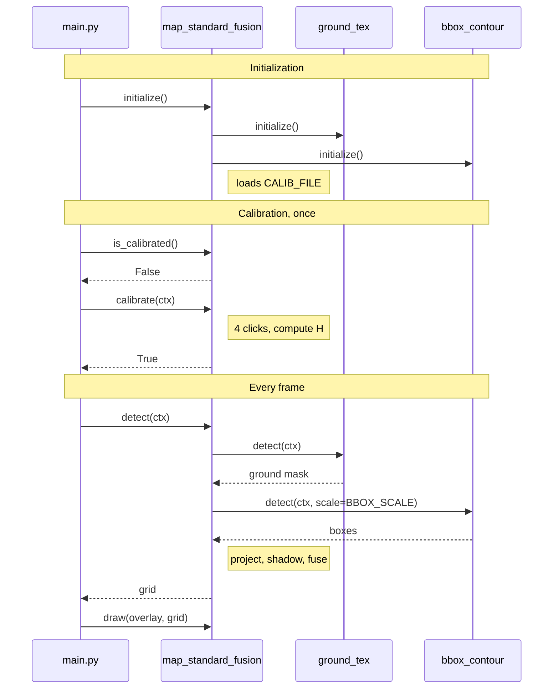

# SWS Map Standard Fusion (MID)

Module: `map_standard_fusion.py` · Status: draft 0.1 · Date: 2026-11-10

## 1 Introduction and functional overview

The `map_standard_fusion` module builds a local, robot-centred 2D occupancy grid from a single camera: it fuses the ground mask of `ground_standard_texture` with the boxes of `bbox_standard_contour`, and expresses the result in meters through a calibrated homography.

Each grid cell is **free**, **obstacle** or **unknown**. The map is recomputed on every frame, with no memory and no robot pose; it is displayed in a third view of the OpenCV HMI, next to the two camera views.

Out of scope for this version: a map accumulated over time, robot pose, depth estimation, object tracking and sending the map to the robot.

## 2 Acronyms and Abbreviations

| Abbreviation / Acronym | Description |
| --- | --- |
| ROI | Region of Interest: the part of the image that is analyzed |
| H | 3×3 homography that maps image pixels of the ground to meters |
| `ctx` | `FrameContext`: `frame`, `gray` and `edges`, computed once per frame |

## 3 Constraints and assumptions

The map is only valid if the following assumptions hold; otherwise it is wrong and the module cannot detect it.

| ID | Assumption |
| --- | --- |
| A1 | The ground is flat between the robot and the far edge of the grid. |
| A2 | The camera is fixed relative to the robot: its height and tilt have not changed since the calibration. |
| A3 | There is a single camera and no depth measurement. The map is local and recomputed on every frame, without robot pose. |
| A4 | The mask of `ground_tex` only covers the lower part of the image (ROI from 60 % to 100 % of the height); elsewhere it is 0. |
| A5 | `bbox_contour` returns pixel rectangles `(x1, y1, x2, y2)`. The map requests them without enlargement (`scale = 1.0`), so the bottom edge of a box is the contact with the ground. |
| A6 | Python with OpenCV and NumPy only; no TensorFlow in this module. |

## 4 Dependencies to other modules

`map_standard_fusion` does not need any result precomputed by `main.py`; it calls the modules below itself.

### 4.1 Internal modules

| Module | Interface | Description |
| --- | --- | --- |
| `ground_standard_texture` (`ground_tex`) | `is_calibrated()`, `calibrate(ctx)`, `detect(ctx)` | Ground mask: `uint8` array of the image size, `> 0` means textured ground. `calibrate` learns the ground texture once, and `is_calibrated()` returns `True` afterwards. |
| `bbox_standard_contour` (`bbox_contour`) | `detect(ctx, scale=1.0)` | List of `(x1, y1, x2, y2)` pixel rectangles. `scale = 1.0` disables the enlargement. |
| `preprocessing` | `FrameContext` | `frame`, `gray` and `edges`, computed once per frame. |

### 4.2 External dependencies

| Library | Functions used | Description |
| --- | --- | --- |
| OpenCV (`cv2`) | `getPerspectiveTransform`, `warpPerspective`, `perspectiveTransform`, `fillPoly`, `setMouseCallback` | Homography, projection, shadow polygons and calibration input. |
| NumPy | `ndarray` (`uint8`) | Storage of the grid and of the masks. |
| `json` (Python standard library) | `load`, `dump` | Reading and writing `CALIB_FILE`. |

## 5 Functional specification

A cell is an obstacle if a box covers it, unknown if it is hidden behind an obstacle, free if the ground mask covers it, and unknown otherwise; the homography from the 4-point calibration gives the pixel-to-meter equivalence.

### 5.1 Grid model

**[SWS_MapFusion_00001]** ⌈ The grid is a `uint8` array of `N_ROWS × N_COLS` cells, with `N_COLS = GRID_WIDTH_M / CELL_SIZE_M` and `N_ROWS = GRID_DEPTH_M / CELL_SIZE_M`. Values: `UNKNOWN = 0`, `FREE = 1`, `OBSTACLE = 2`. ⌋

**[SWS_MapFusion_00002]** ⌈ The robot frame has its origin at the ground point below the camera, the x axis to the right and the y axis forward, in meters. The grid covers x in `[-GRID_WIDTH_M/2, +GRID_WIDTH_M/2]` and y in `[0, GRID_DEPTH_M]`. ⌋

**[SWS_MapFusion_00003]** ⌈ Row 0 of the grid is the farthest from the robot and column 0 is on the left, so the robot is at the bottom centre when the grid is displayed. ⌋

**[SWS_MapFusion_00004]** ⌈ Each call of `detect` starts from a grid where every cell is `UNKNOWN`. ⌋

### 5.2 Source interpretation

**[SWS_MapFusion_00010]** ⌈ A ground mask pixel with a value `> 0` means textured ground. The mask is projected into the grid with `cv2.warpPerspective` (nearest-neighbour interpolation); a cell whose projection is `> 0` is a `FREE` candidate. ⌋

**[SWS_MapFusion_00011]** ⌈ A ground mask pixel equal to 0, or outside the camera field of view, brings no information: the cell stays `UNKNOWN`. ⌋

**[SWS_MapFusion_00012]** ⌈ For each box `(x1, y1, x2, y2)`, the segment `(x1, y2)` to `(x2, y2)` (bottom edge, contact with the ground) is projected with `cv2.perspectiveTransform`, drawn in the grid and thickened by `OBSTACLE_MARGIN_CELLS` cells. The cells it touches are `OBSTACLE` candidates. ⌋

**[SWS_MapFusion_00013]** ⌈ A box whose projected segment lies entirely outside the grid is ignored. ⌋

### 5.3 Fusion

**[SWS_MapFusion_00020]** ⌈ The fusion gives each cell the state of the first matching condition in this table: ⌋

| Priority | Condition | Cell state |
| --- | --- | --- |
| 1 | The cell is on the contact segment of a box (margin included). | `OBSTACLE` |
| 2 | The cell is in the shadow of a box (SWS_MapFusion_00021). | `UNKNOWN` |
| 3 | The ground mask covers the cell. | `FREE` |
| 4 | None of the above. | `UNKNOWN` |

**[SWS_MapFusion_00021]** ⌈ Whatever is hidden is `UNKNOWN` for safety. The shadow of a box is the region behind its projected contact segment: the cells farther from the robot origin than the segment, within the angle that the two segment ends span as seen from the origin. It is the polygon made of the two segment ends and their extensions along the rays from the origin to the grid border. ⌋

**[SWS_MapFusion_00022]** ⌈ The absence of a box is never information: it does not make a cell free. ⌋

**[SWS_MapFusion_00023]** ⌈ There is no temporal memory: two successive frames give two independent maps. ⌋

### 5.4 Pixel-to-meter calibration

**[SWS_MapFusion_00030]** ⌈ The calibration computes the homography `H` (3×3) that maps a ground pixel to meters in the robot frame, from 4 correspondences between image points and ground points. ⌋

**[SWS_MapFusion_00031]** ⌈ Procedure: lay a rectangle of `CALIB_RECT_WIDTH_M × CALIB_RECT_DEPTH_M` on the floor, centred laterally, with its near edge at `CALIB_RECT_NEAR_M` from the robot. On the frozen image, the operator clicks the 4 corners in this order: near left, near right, far right, far left. ⌋

**[SWS_MapFusion_00032]** ⌈ The matching ground points, in meters, are `(-W/2, d)`, `(+W/2, d)`, `(+W/2, d+L)`, `(-W/2, d+L)`, with `W = CALIB_RECT_WIDTH_M`, `L = CALIB_RECT_DEPTH_M` and `d = CALIB_RECT_NEAR_M`. ⌋

**[SWS_MapFusion_00033]** ⌈ `H = cv2.getPerspectiveTransform(image_points, ground_points)`. The grid projection is `H` followed by a fixed scaling from meters to cell indices: `column = (x + GRID_WIDTH_M/2) / CELL_SIZE_M` and `row = (GRID_DEPTH_M - y) / CELL_SIZE_M`. ⌋

**[SWS_MapFusion_00034]** ⌈ The input is an OpenCV window: left click adds a point, `r` restarts, Enter validates, Esc cancels. ⌋

**[SWS_MapFusion_00035]** ⌈ After validation, the module overlays a metric grid (one line every `DRAW_GRID_STEP_M`) on the image for visual control. An optional 5th click on a point of known position shows the position error in centimeters. ⌋

**[SWS_MapFusion_00036]** ⌈ After validation, the module shows the ground resolution in centimeters per pixel at 1 m, 2 m and 3 m. It is not uniform and degrades with distance. ⌋

**[SWS_MapFusion_00037]** ⌈ `H` is saved in `CALIB_FILE` (JSON: image points, ground points, `H`, image resolution, date). `initialize` reloads it if the image resolution is the same. ⌋

**[SWS_MapFusion_00038]** ⌈ Any change of camera height or tilt invalidates `H`: a new calibration is required. ⌋

### 5.5 Error classification

| Error code | Value [hex] | Type | Description |
| --- | --- | --- | --- |
| `MAP_E_NOT_INITIALIZED` | 0x01 | Development | `detect` or `calibrate` called before `initialize`: `RuntimeError`. |
| `MAP_E_NOT_CALIBRATED` | 0x02 | Runtime | `detect` without calibration: every cell is `UNKNOWN`, and a warning is printed once. |
| `MAP_E_CALIB_ABORTED` | 0x03 | Runtime | Esc during the calibration: `calibrate` returns `False` and the previous state is kept. |
| `MAP_E_CALIB_FILE` | 0x04 | Runtime | `CALIB_FILE` missing, unreadable or of a different resolution: ignored, the module stays uncalibrated. |
| `MAP_E_BAD_FRAME` | 0x05 | Development | `ctx.frame` empty or of a different resolution than the calibration: `ValueError`. |

## 6 API specification

The module exposes the four common functions `initialize`, `calibrate`, `detect` and `draw`, plus four helper functions for the pixel-to-meter equivalence.

### 6.1 Type definitions

**[SWS_MapFusion_00050]** ⌈ Type definitions of the module: ⌋

| Name | Kind | Range | Description |
| --- | --- | --- | --- |
| `CellState` | `IntEnum` | `UNKNOWN = 0`, `FREE = 1`, `OBSTACLE = 2` | State of a grid cell. |
| `Grid` | `numpy.ndarray`, `uint8` | shape `(N_ROWS, N_COLS)`, values of `CellState` | Occupancy grid, robot at the bottom centre. |

### 6.2 Function definitions

#### 6.2.1 initialize

**[SWS_MapFusion_00100]** ⌈ Definition of `initialize`: ⌋

| Service name | `initialize` |
| --- | --- |
| Syntax | `initialize() -> None` |
| Sync/Async | Synchronous |
| Reentrancy | Non reentrant |
| Parameters (in) | None |
| Return value | None |
| Description | Initializes `ground_tex` and `bbox_contour`, computes `N_ROWS` and `N_COLS`, and loads `CALIB_FILE` if it exists (SWS_MapFusion_00037). Must be called once before any other function. |

#### 6.2.2 calibrate

**[SWS_MapFusion_00101]** ⌈ Definition of `calibrate`: ⌋

| Service name | `calibrate` |
| --- | --- |
| Syntax | `calibrate(ctx=None) -> bool` |
| Sync/Async | Synchronous (blocks until the operator validates or cancels) |
| Reentrancy | Non reentrant |
| Parameters (in) | `ctx`: `FrameContext` whose `ctx.frame` is frozen for the selection of the 4 points. If `None`, the module reads the camera itself. |
| Return value | `True` if the calibration is validated and saved; `False` if cancelled (`MAP_E_CALIB_ABORTED`). |
| Description | Interactive procedure of 5.4. Called by `main.py` as long as `is_calibrated()` returns `False`. |

#### 6.2.3 is_calibrated

**[SWS_MapFusion_00102]** ⌈ Definition of `is_calibrated`: ⌋

| Service name | `is_calibrated` |
| --- | --- |
| Syntax | `is_calibrated() -> bool` |
| Sync/Async | Synchronous |
| Reentrancy | Reentrant |
| Parameters (in) | None |
| Return value | `True` if `H` is available. |
| Description | Tells whether the pixel-to-meter equivalence is known. |

#### 6.2.4 detect

**[SWS_MapFusion_00103]** ⌈ Definition of `detect`: ⌋

| Service name | `detect` |
| --- | --- |
| Syntax | `detect(ctx) -> Grid` |
| Sync/Async | Synchronous |
| Reentrancy | Non reentrant |
| Parameters (in) | `ctx`: `FrameContext` of the current frame. |
| Return value | The fused grid of 5.3; every cell is `UNKNOWN` if the module is not calibrated. |
| Description | Calls `ground_tex.calibrate(ctx)` if `ground_tex.is_calibrated()` is `False`, then `ground_tex.detect(ctx)` and `bbox_contour.detect(ctx, scale=BBOX_SCALE)`. Projects both results (5.2), applies the shadow rule and fuses (5.3). |

#### 6.2.5 draw

**[SWS_MapFusion_00104]** ⌈ Definition of `draw`: ⌋

| Service name | `draw` |
| --- | --- |
| Syntax | `draw(overlay, grid) -> None` |
| Sync/Async | Synchronous |
| Reentrancy | Non reentrant |
| Parameters (in) | `overlay`: BGR image of the view. `grid`: result of `detect`. |
| Return value | None |
| Description | Replaces the content of `overlay` with the grid scaled to the view (nearest neighbour, aspect ratio kept, black bands). `UNKNOWN` is gray, `FREE` green and `OBSTACLE` red; ticks every `DRAW_GRID_STEP_M`, robot at the bottom centre. The view keeps the size of the other views, which `cv2.hconcat` requires. |

#### 6.2.6 pixel_to_ground

**[SWS_MapFusion_00105]** ⌈ Definition of `pixel_to_ground`: ⌋

| Service name | `pixel_to_ground` |
| --- | --- |
| Syntax | `pixel_to_ground(u, v) -> tuple[float, float] \| None` |
| Sync/Async | Synchronous |
| Reentrancy | Reentrant |
| Parameters (in) | `u`, `v`: pixel column and row. |
| Return value | `(x, y)` in meters in the robot frame, or `None` if not calibrated. |
| Description | Ground position of the pixel `(u, v)`; valid for a pixel that touches the ground (A1). |

#### 6.2.7 ground_to_pixel

**[SWS_MapFusion_00106]** ⌈ Definition of `ground_to_pixel`: ⌋

| Service name | `ground_to_pixel` |
| --- | --- |
| Syntax | `ground_to_pixel(x, y) -> tuple[int, int] \| None` |
| Sync/Async | Synchronous |
| Reentrancy | Reentrant |
| Parameters (in) | `x`, `y`: position in meters in the robot frame. |
| Return value | The pixel `(u, v)`, or `None` if not calibrated. |
| Description | Inverse transformation (inverse of `H`); used to draw the metric control grid (SWS_MapFusion_00035). |

#### 6.2.8 ground_resolution

**[SWS_MapFusion_00107]** ⌈ Definition of `ground_resolution`: ⌋

| Service name | `ground_resolution` |
| --- | --- |
| Syntax | `ground_resolution(u, v) -> tuple[float, float] \| None` |
| Sync/Async | Synchronous |
| Reentrancy | Reentrant |
| Parameters (in) | `u`, `v`: pixel column and row. |
| Return value | `(dx, dy)` in meters per pixel, or `None` if not calibrated. |
| Description | Ground size of one pixel at `(u, v)`, computed with `pixel_to_ground` on two neighbouring pixels; used by SWS_MapFusion_00036. |

## 7 Sequence diagrams

Initialization loads the calibration file if it exists; `main.py` runs `calibrate` as long as `is_calibrated()` returns `False`, then every frame calls `detect` and `draw`.

## 8 Configuration specification

The parameters are constants at the top of `map_standard_fusion.py`. The defaults give a grid of 80 × 80 cells; adjust them to what the camera really sees.

| Parameter name | Type | Range | Default | Description |
| --- | --- | --- | --- | --- |
| `GRID_WIDTH_M` | float | > 0 | 4.0 | Grid width, in meters. |
| `GRID_DEPTH_M` | float | > 0 | 4.0 | Grid depth in front of the robot, in meters. |
| `CELL_SIZE_M` | float | > 0 | 0.05 | Side of one cell, in meters. |
| `OBSTACLE_MARGIN_CELLS` | int | ≥ 0 | 1 | Thickness added around the contact segment of a box. |
| `BBOX_SCALE` | float | > 0 | 1.0 | Enlargement requested from `bbox_contour`; 1.0 means none. |
| `CALIB_RECT_WIDTH_M` | float | > 0 | 0.40 | Width of the rectangle laid on the floor for the calibration. |
| `CALIB_RECT_DEPTH_M` | float | > 0 | 0.60 | Depth of that rectangle. |
| `CALIB_RECT_NEAR_M` | float | ≥ 0 | 0.30 | Distance between the robot and the near edge of the rectangle. |
| `CALIB_FILE` | str | file path | `map_calibration.json` | File where `H` is saved. |
| `DRAW_GRID_STEP_M` | float | > 0 | 0.5 | Spacing of the ticks in the view and of the control grid. |
