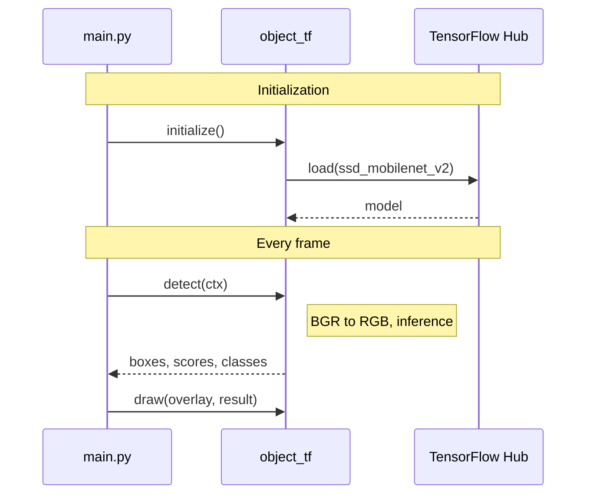

# SWS Object TensorFlow SSD (MID)

Module: `object_tensorflow_ssd.py` · Status: draft 0.1 · Date: 2026-11-14

## 1 Introduction and functional overview

The `object_tensorflow_ssd` module detects objects in the camera frame with a pre-trained TensorFlow model (SSD MobileNet v2, trained on the COCO dataset). For each detected object it returns a bounding box, a confidence score and a class identifier, and it can draw them with the name of the class.

In the project, the module is the AI reference: it is shown in a view of the OpenCV HMI and it is the source of truth of `bbox_standard_tuning`.

Out of scope for this version: training or fine tuning of the model, filtering of the classes (done by the callers), tracking, and the choice of another model.

## 2 Acronyms and Abbreviations

| Abbreviation / Acronym | Description |
| --- | --- |
| COCO | Dataset whose 90 object classes (numbered from 1) the model recognises. |
| SSD | Single Shot Detector: type of model that gives all the boxes in one pass. |
| `ctx` | `FrameContext`: `frame`, `gray` and `edges`, computed once per frame. |

## 3 Constraints and assumptions

| ID | Assumption |
| --- | --- |
| O1 | TensorFlow and `tensorflow_hub` are installed. |
| O2 | The first `initialize` downloads the model from TensorFlow Hub: it needs a network access, and it takes time. |
| O3 | `ctx.frame` is a BGR `uint8` image of shape `(height, width, 3)`; the model accepts any size. |
| O4 | Every call of `detect` runs an inference: it is the most expensive step of a frame. |
| O5 | The model only knows the 90 classes of COCO; other objects are ignored or given a wrong class. |
| O6 | The module keeps the model in a global variable and is not meant to be called from several threads. |

## 4 Dependencies to other modules

`object_tensorflow_ssd` does not call any other module of the project; it only reads the `ctx` it receives.

### 4.1 Internal modules

| Module | Interface | Description |
| --- | --- | --- |
| `preprocessing` | `FrameContext` | `ctx.frame`: raw BGR frame. |

### 4.2 External dependencies

| Library | Functions used | Description |
| --- | --- | --- |
| TensorFlow (`tf`) | `convert_to_tensor`, `expand_dims` | Conversion of the frame into the input tensor. |
| `tensorflow_hub` (`hub`) | `load` | Download and load of the model `https://tfhub.dev/tensorflow/ssd_mobilenet_v2/2`. |
| OpenCV (`cv2`) | `cvtColor`, `rectangle`, `putText` | BGR to RGB conversion and drawing. |
| NumPy | `ndarray` | Arrays returned by the model. |

## 5 Functional specification

The module converts the frame to RGB, runs the model, and returns the boxes, the scores and the classes it gives, without any filtering; drawing applies a score threshold.

### 5.1 Model loading

**[SWS_ObjectTF_00001]** ⌈ `initialize` loads the model `https://tfhub.dev/tensorflow/ssd_mobilenet_v2/2` once. A second call does nothing. ⌋

**[SWS_ObjectTF_00002]** ⌈ A failure of the loading (no network, model not found) is not caught: the exception of `tensorflow_hub` reaches the caller. ⌋

### 5.2 Detection

**[SWS_ObjectTF_00010]** ⌈ `detect` converts `ctx.frame` from BGR to RGB, makes a `uint8` tensor of it with a batch dimension, and runs the model on it. ⌋

**[SWS_ObjectTF_00011]** ⌈ The result is made of three arrays, taken from the first (and only) image of the batch: `boxes` of shape `[N, 4]` with the normalised coordinates `(ymin, xmin, ymax, xmax)` in `[0, 1]`, `scores` of shape `[N]` in `[0, 1]`, and `classes` of shape `[N]` with the COCO class identifiers (as floating point numbers). `N` is the number of detections given by the model. ⌋

**[SWS_ObjectTF_00012]** ⌈ `detect` does not filter the detections: all of them are returned, whatever their score. The detections are ordered by decreasing score, as given by the model. ⌋

### 5.3 Drawing

**[SWS_ObjectTF_00020]** ⌈ `draw` shows only the detections whose score is greater than or equal to `score_threshold`. The coordinates are multiplied by the size of the overlay: `x = int(xmin * width)`, `y = int(ymin * height)`. ⌋

**[SWS_ObjectTF_00021]** ⌈ Each shown detection is a green rectangle with the text `name (score %)` above its top left corner (at least 20 pixels from the top of the image). The name comes from the table `LABELS` (index = class identifier); an identifier outside the table gives `class <identifier>`. ⌋

### 5.4 Error classification

| Error code | Value [hex] | Type | Description |
| --- | --- | --- | --- |
| `OBJ_E_NOT_INITIALIZED` | 0x01 | Development | `detect` called before `initialize`: `RuntimeError`. |

## 6 API specification

The module exposes the four common functions `initialize`, `calibrate`, `detect` and `draw`.

### 6.1 Type definitions

**[SWS_ObjectTF_00050]** ⌈ Type definitions of the module: ⌋

| Name | Kind | Range | Description |
| --- | --- | --- | --- |
| `Detections` | `tuple[ndarray, ndarray, ndarray]` | `(boxes, scores, classes)` of SWS_ObjectTF_00011 | Result of `detect`. |

### 6.2 Function definitions

#### 6.2.1 initialize

**[SWS_ObjectTF_00100]** ⌈ Definition of `initialize`: ⌋

| Service name | `initialize` |
| --- | --- |
| Syntax | `initialize() -> None` |
| Sync/Async | Synchronous |
| Reentrancy | Non reentrant |
| Parameters (in) | None |
| Return value | None |
| Description | Loads the model (SWS_ObjectTF_00001). Must be called once at start-up, before `detect`. |

#### 6.2.2 calibrate

**[SWS_ObjectTF_00101]** ⌈ Definition of `calibrate`: ⌋

| Service name | `calibrate` |
| --- | --- |
| Syntax | `calibrate(ctx=None) -> None` |
| Sync/Async | Synchronous |
| Reentrancy | Reentrant |
| Parameters (in) | `ctx`: ignored. |
| Return value | None |
| Description | The model needs no frame-based initialisation: does nothing. Present for the common interface of the detection modules. |

#### 6.2.3 detect

**[SWS_ObjectTF_00102]** ⌈ Definition of `detect`: ⌋

| Service name | `detect` |
| --- | --- |
| Syntax | `detect(ctx) -> Detections` |
| Sync/Async | Synchronous |
| Reentrancy | Non reentrant |
| Parameters (in) | `ctx`: `FrameContext` of the current frame. |
| Return value | `(boxes, scores, classes)` of SWS_ObjectTF_00011. |
| Description | Runs the model on `ctx.frame` (SWS_ObjectTF_00010). Raises `RuntimeError` if the module is not initialised (`OBJ_E_NOT_INITIALIZED`). |

#### 6.2.4 draw

**[SWS_ObjectTF_00103]** ⌈ Definition of `draw`: ⌋

| Service name | `draw` |
| --- | --- |
| Syntax | `draw(overlay, result, score_threshold=0.5) -> None` |
| Sync/Async | Synchronous |
| Reentrancy | Non reentrant |
| Parameters (in) | `overlay`: BGR image of the view, modified in place. `result`: `Detections` returned by `detect`. `score_threshold`: smallest score shown. |
| Return value | None |
| Description | Draws the detections as in 5.3. |

## 7 Sequence diagrams

## 8 Configuration specification

The module has no tunable constant: the model is fixed in `initialize` and the class names are the table `LABELS` at the top of the file. The only parameter is the argument of `draw`.

| Parameter name | Type | Range | Default | Description |
| --- | --- | --- | --- | --- |
| `score_threshold` | float | [0, 1] | 0.5 | Argument of `draw`: smallest score of a detection that is shown. |
