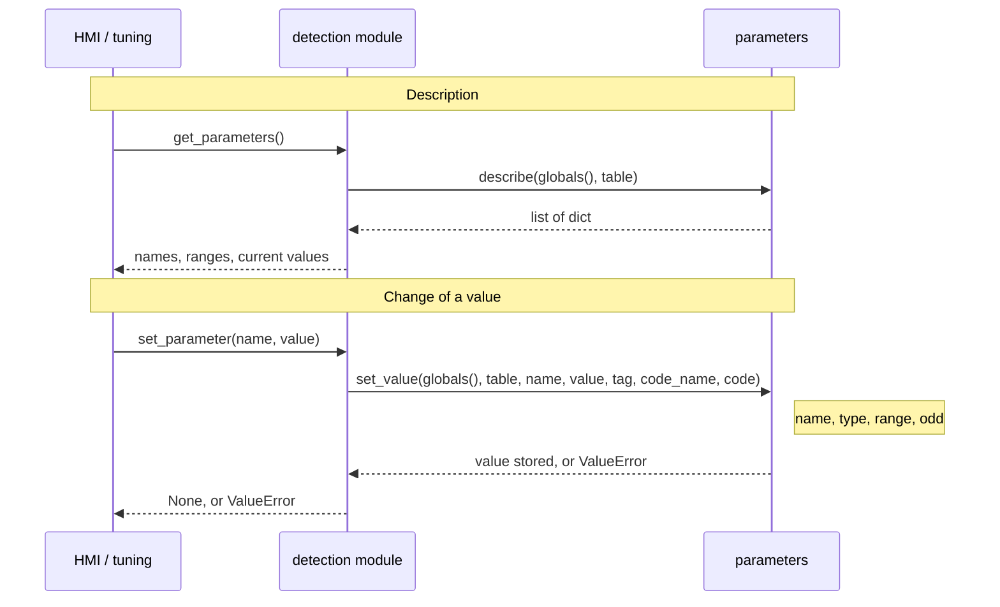

# SWS Parameters (MID)

## 1 Introduction and functional overview

The `parameters` module gives the detection modules a common way to describe and change their adjustable parameters. A detection module keeps its parameters as global variables and lists the ones that can be changed at run time in a table of `Parameter`. Its functions `get_parameters`, `get_parameter` and `set_parameter` call the functions of this module, so that the HMI and the tuning modules see the same interface whatever the module.

The module is not a detection module: it has no `initialize`, `calibrate`, `detect` or `draw`, no state, and it does not know any model. It describes the parameters, reads their value and checks a new value before it is stored.

## 2 Acronyms and Abbreviations

| Abbreviation / Acronym | Description |
| --- | --- |
| Parameter | Description of one adjustable parameter of a module: name, type, range, unit, description and whether the value must be odd. |
| Table | Tuple of `Parameter` that a module declares for its adjustable parameters. |
| Namespace | `dict` of the global variables of the module (`globals()`), where the values of the parameters are stored. |
| Tag | Name of the calling module in the error messages. |

## 3 Constraints and assumptions

- The namespace is the dictionary of the global variables of the calling module, and every name of its table exists in it. *Why:* the value is read from and written to that dictionary; this is how a change of a parameter is seen by the functions of the calling module at their next call. The module does not check that the names exist.
- The values of the table are consistent (`minimum <= maximum`, the default is in the range). *Why:* the table is written by the developer of the calling module; checking it at each call would cost time for no gain.
- The module is not meant to be called from several threads. *Why:* a write is not protected, so a function that reads the parameter at the same time could see the old or the new value.
- Only the numeric types `int` and `float` are supported. *Why:* the HMI builds one slider or field per parameter from the range; other kinds of values (modules, lists, strings) are configuration of the module (section 8.2 of its specification).

## 4 Dependencies to other modules

The module `parameters` has interfaces and dependencies to the following modules:

### 4.1 Internal modules

None.

### 4.2 External dependencies

None.

## 5 Functional specification

A module declares a table of parameters. The functions of this module describe them, read their value and write a new value after the checks.

### 5.1 Parameter description

**[SWS_Parameters_00001]** A `Parameter` has the fields `name` (name of the global variable), `type` (`int` or `float`), `minimum` and `maximum` (inclusive bounds), `unit` (text, for example `"px"`, `"m"`, `"ratio"`), `description` (text) and `odd` (`bool`, `False` by default). The name is the one of the variable, so the table is the only place where a parameter is described and the HMI needs no other information.

**[SWS_Parameters_00002]** `describe` returns one `dict` per `Parameter`, in the order of the table, with the keys `name`, `type` (`"int"` or `"float"`), `minimum`, `maximum`, `unit`, `description` and `value` (current value read from the namespace). The type is a text so that the result can be displayed or saved without importing anything. The `odd` field is not returned.

### 5.2 Reading

**[SWS_Parameters_00010]** `get_value` returns the current value of the parameter in the namespace. A name that is not in the table is refused (SWS_Parameters_00021). Only the parameters of the table are readable, so that the interface does not expose the other variables of the module.

### 5.3 Writing

**[SWS_Parameters_00020]** `set_value` checks the new value, in this order: the name is in the table; the value is not a boolean; the value has the type of the parameter (an integer for `int`, any real number for `float`, converted to `float`); the value is in the range `[minimum, maximum]`; the value is odd if `odd` is `True`. If all the checks pass, the value is stored in the namespace. A boolean is a number for Python, but a switch given by mistake to a slider is a bug. An integer parameter does not accept `4.0` because a size in pixels must not be rounded silently. Values such as `nan` and `inf` are refused by the range check.

**[SWS_Parameters_00021]** If a check fails, `set_value` raises a `ValueError` and the value is not changed. The message is `[tag] code_name (0xNN): details`, where `tag`, `code_name` and `code` are given by the caller, so that the error is reported with the name and the code of the calling module (for example `BBOX_E_BAD_PARAMETER`). The module has no error code of its own.

**[SWS_Parameters_00022]** `set_value` does not check the consistency between parameters (for example a minimum area greater than a maximum area). Each parameter has its own range; a check between parameters would depend on the model and belongs to the calling module.

## 6 API specification

The module exposes the three functions `describe`, `get_value` and `set_value`, and the type `Parameter`.

### 6.1 Type definitions

The following Data Types shall be used for the functions defined in this specification.

**[SWS_Parameters_00050]** Type definitions of the module:

| Name | Kind | Range | Description |
| --- | --- | --- | --- |
| `Parameter` | `namedtuple` | SWS_Parameters_00001 | Description of one adjustable parameter. `odd` is optional. |

### 6.2 Function definitions

This is a list of functions provided for upper layer modules.

#### 6.2.1 describe

**[SWS_Parameters_00100]** Definition of `describe`:

| Service name | `describe` |
| --- | --- |
| Syntax | `describe(namespace, table) -> list[dict]` |
| Sync/Async | Synchronous |
| Reentrancy | Reentrant |
| Parameters (in) | `namespace`: global variables of the calling module. `table`: tuple of `Parameter`. |
| Return value | One `dict` per parameter, as in SWS_Parameters_00002. |
| Description | Used by `get_parameters` of the detection modules. |

#### 6.2.2 get_value

**[SWS_Parameters_00101]** Definition of `get_value`:

| Service name | `get_value` |
| --- | --- |
| Syntax | `get_value(namespace, table, name, tag, code_name, code) -> int or float` |
| Sync/Async | Synchronous |
| Reentrancy | Reentrant |
| Parameters (in) | `namespace`, `table`: as for `describe`. `name`: name of a parameter of the table. `tag`, `code_name`, `code`: module name, error name and error code for the message of the error. |
| Return value | Current value of the parameter. |
| Description | Applies SWS_Parameters_00010. Raises `ValueError` for an unknown name (SWS_Parameters_00021). |

#### 6.2.3 set_value

**[SWS_Parameters_00102]** Definition of `set_value`:

| Service name | `set_value` |
| --- | --- |
| Syntax | `set_value(namespace, table, name, value, tag, code_name, code) -> None` |
| Sync/Async | Synchronous |
| Reentrancy | Non reentrant (writes the namespace) |
| Parameters (in) | `namespace`, `table`, `name`, `tag`, `code_name`, `code`: as for `get_value`. `value`: new value. |
| Return value | None |
| Description | Applies SWS_Parameters_00020 and 00021. |

## 7 Sequence diagrams

A detection module calls this module from its three parameter functions; the HMI and the tuning only talk to the detection module.

## 8 Configuration specification

The module has no configuration parameter.
