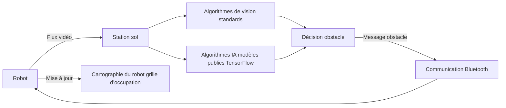

# Minstorm Object Detection (MID)

MinstormObjectDetection est un projet visant à implémenter une stratégie de détection d’obstacles à partir d’un flux vidéo fourni par un robot. Il constitue la première brique fonctionnelle pour améliorer l’autonomie et l’intelligence du robot.

Contrairement à une approche classique reposant uniquement sur des capteurs de distance (télémètre) ou de collision (capteur tactile), ce projet introduit une détection intelligente basée sur la vision, permettant de :

* identifier des obstacles visuellement
* qualifier leur présence de manière plus fiable
* intégrer ces informations directement dans la cartographie du robot

L’IA sert actuellement à valider les algorithmes standards. L’architecture pourra évoluer pour que l’IA devienne décisionnaire, avec les algos standards en garde-fou, notamment si le projet est déployé sur un système embarqué type edge impulse.

## Principe général

La station sol analyse le flux vidéo remonté par le robot, détecte les obstacles, puis renvoie les informations pertinentes au robot via Bluetooth sous forme de messages JSON. Le robot décode ces messages et met à jour sa cartographie automatiquement.

## Stratégie de détection

### Détection standards (référence nominale)

Les algorithmes standards de vision par ordinateur constituent la chaîne de détection principale. Ils sont privilégiés pour :

* leur temps d’exécution maîtrisé,
* leur comportement déterministe,
* leur facilité de calibration et de débogage.

Ils peuvent inclure, selon les cas d’usage :

* détection de contours et de formes,
* segmentation par couleur ou par profondeur apparente,
* détection de mouvement (différentiel d’images),
* filtrage morphologique et heuristiques géométriques.

Leur sortie produit une hypothèse d’obstacle (présence, position relative, taille estimée).

### Détection basée sur l’IA (validation et plausibilisation)

Le projet intègre des algorithmes de détection basés sur IA, reposant exclusivement sur des modèles publics pré‑entraînés (TensorFlow).

Ces algorithmes ne constituent pas la source décisionnelle principale. Leur rôle est de confirmer ou invalider les résultats issus des algorithmes standards. La détection IA permet de :

* vérifier la cohérence d’une détection standard (plausibilisation),
* réduire les faux positifs dus à des artefacts visuels,
* détecter des obstacles difficiles à caractériser par des règles simples,
* apporter une mesure de confiance supplémentaire.

La confirmation est basée sur :
* Les algorithmes standards produisent une ou plusieurs hypothèses d’obstacles.
* Les algorithmes IA analysent le même flux vidéo (ou une région d’intérêt).
* Les résultats IA sont comparés aux hypothèses standards selon des critères tels que :
   * recouvrement spatial (overlap),
   * cohérence de position,
   * présence d’une classe d’objet plausible.
  
La confirmation de l'obstacle (confirmé, incertain voire rejeté) est ensuite transmise au robot.

## Démarrage

Prérequis : Python 3.9 ou plus, une caméra (index 1 par défaut dans `main.py`).

### Sous VS Code

1. Ouvrir le dossier du dépôt (ou `MID.code-workspace`) et installer les extensions recommandées.
2. Lancer la tâche `MID: setup environment` (Terminal > Exécuter la tâche) : crée `.venv` et installe `requirements.txt`.
3. Sélectionner l'interpréteur `.venv` si VS Code le demande.
4. F5 avec la configuration `MID main` (ou `MID test`).

Sous Linux/macOS, remplacer `.venv/Scripts/python.exe` par `.venv/bin/python` dans `.vscode/settings.json` et `.vscode/tasks.json`.

### Sous Visual Studio

1. Ouvrir `MID/MID.sln`.
2. Créer ou choisir un environnement Python 3.9+ (fenêtre « Environnements Python ») et installer les paquets de `requirements.txt`.
3. Démarrer avec `main.py` (fichier de démarrage du projet).

Visual Studio reste supporté pendant la période de migration vers VS Code.

### Vérification dans les deux IDE

- [ ] Environnement créé à partir de `requirements.txt`.
- [ ] `main.py` démarre et la caméra s'ouvre.
- [ ] Un point d'arrêt dans le `detect` d'un module est atteint.
- [ ] `CALIB_FILE` est lu et écrit dans le dossier attendu.
- [ ] `object_tensorflow_ssd` se charge (ou l'absence de TensorFlow est gérée).
- [ ] Les spécifications Markdown sont lisibles.
